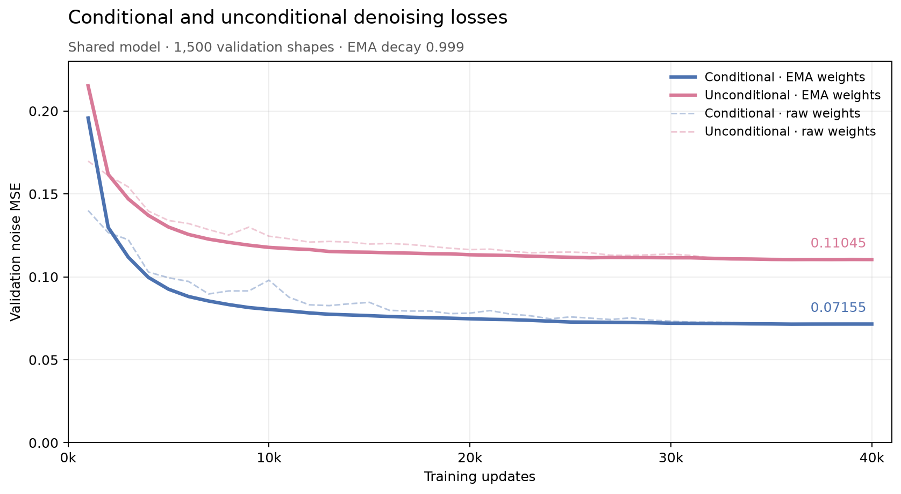
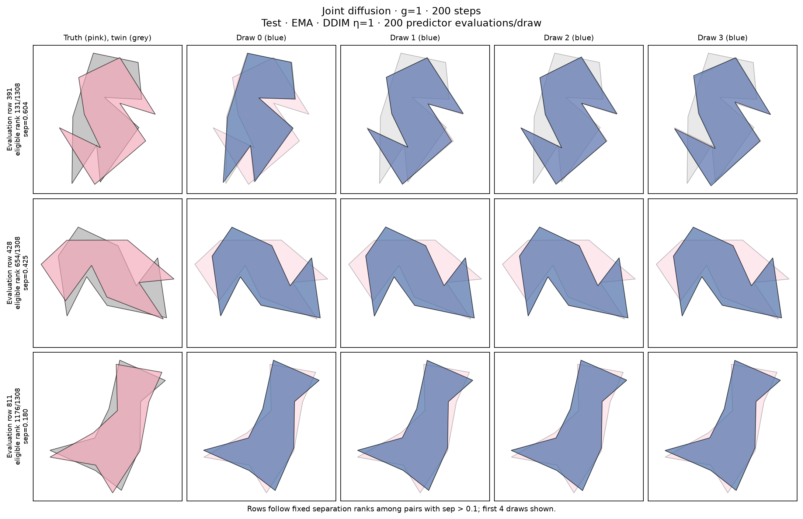
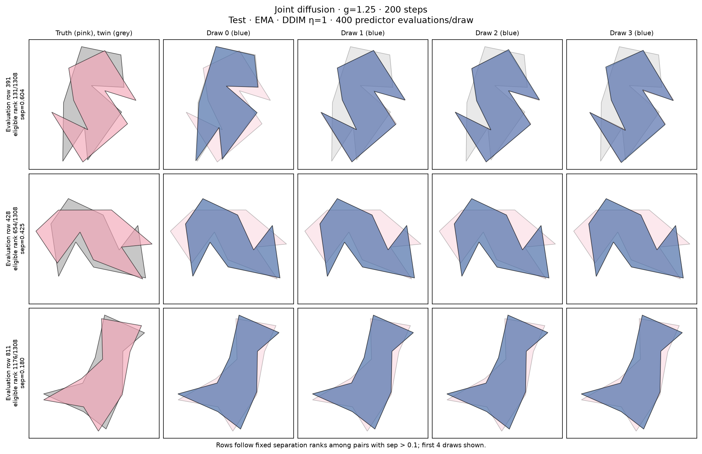
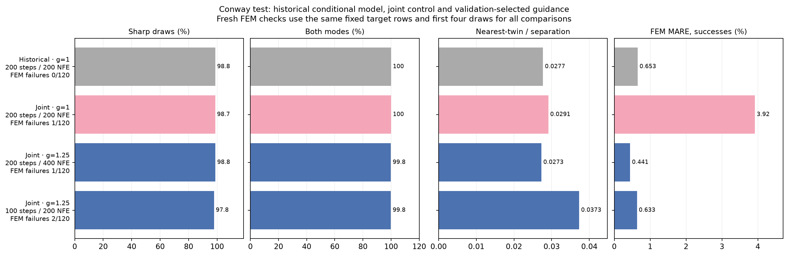
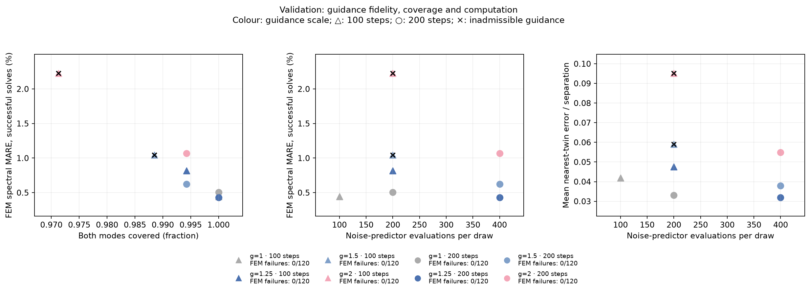
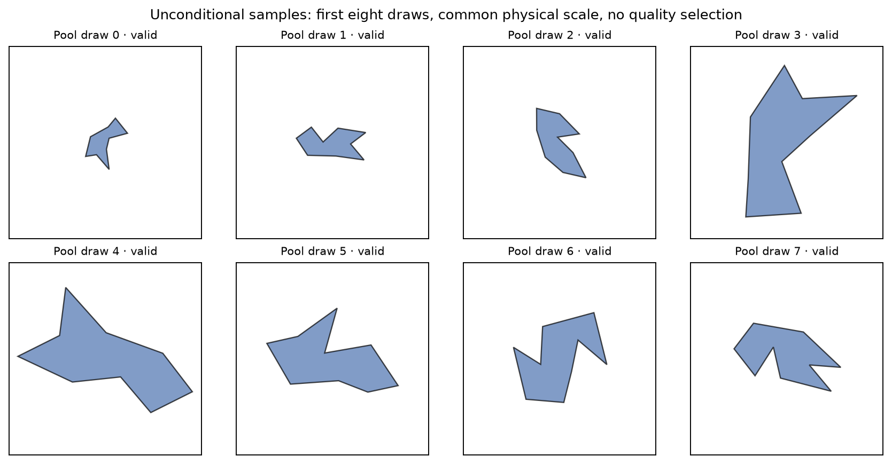

# Classifier-free diffusion guidance on Conway drums

Experiments extending the [conditional diffusion study](diffusion_dataset_experiments.md) with a shared conditional/unconditional model and classifier-free guidance (CFG). One main-ratio model was trained, followed by a frozen validation sweep and three full held-out comparisons. Each test setting generated 16 draws for each of 1,500 spectra. These single-seed results were completed on 16 November 2026.

The question is whether guidance improves proximity to the known isospectral solutions while retaining both alternatives. The unconditional branch also lets us sample the learned shape prior without supplying a spectrum. This remains a controlled inverse-ambiguity experiment within the Conway family.

## Summary

* **Joint training retains the known ambiguity.** Ordinary conditional sampling from the joint model gives 98.710% sharp test draws, and all 1,308 separated pairs contain sharp samples near both known drums among 16 draws.
* **Mild guidance improves some fidelity measures at additional cost.** At 200 steps, g=1.25 raises sharpness to 98.815%, lowers nearest-twin/separation error from 0.02912 to 0.02730, and lowers the successful-solve FEM median from 0.415% to 0.317%. Both-mode coverage decreases slightly to 1,306/1,308 pairs, and predictor calls double.
* **Matched computation gives a different tradeoff.** Guided100 and ordinary conditional200 both use 200 predictor evaluations per draw. Guided100 is slightly faster here, but gives lower sharpness, larger nearest-twin error, a higher FEM median and more invalid selected boundaries.
* **The model can sample without a spectrum.** The unconditional population contains 3,195 valid boundaries out of 3,200 draws. Saved g0 and explicit-null samples are identical under matching keys. These are prior-generation diagnostics, not evidence of conditional reconstruction or posterior calibration.
* **Guidance was chosen on validation only.** The frozen rule selected g=1.25 among guided candidates at both step budgets before any new test evaluation. Test results did not revise the choice.

## Setup

### Data and comparison models

The dataset contains 30,000 Conway rows, each storing a nine-vertex drum, its known isospectral twin and 30 finite-element eigenvalues. These are two known alternatives; the construction does not establish that they are the only shapes matching the finite supplied spectrum. The first 27,000 rows are training data, the next 1,500 validation data, and the final 1,500 test data.

This study uses the **main arm**: one randomly chosen member of each training pair. Conditioning uses standardized log eigenvalue ratios and log(lambda_1), retaining spectral scale information. Feature statistics and the single RMS coordinate scale are fitted on training data only. Shapes and Gaussian noise are centered; physical size is preserved and restored for the forward-spectrum checks.

The historical reference is the original conditional-only main-ratio model. Its saved test polygons received a fresh FEM evaluation on the current matched rows, with seed 20261116. Its physical-error figures therefore differ from the earlier report's seed-20261112 subset. The old checkpoint, samples and original measurements were preserved. The historical and joint models differ in condition dropout and context architecture; the guidance comparisons within the joint model use the same trained weights.

### Conditional dropout and guidance

The network receives the noisy polygon, time and spectral context. An explicit presence bit distinguishes an absent condition from a genuine zero standardized spectrum:

```
spectral context = [r * c, r]
```

Each example independently uses r=0 with probability 0.1. Time remains available, and dropout does not change the sampled timesteps or Gaussian corruption. Training predicts the added centered Gaussian noise by squared error, using the equivariant RingTransformer backbone.

At sampling time,

```
epsilon_g = epsilon_u + g * (epsilon_c - epsilon_u)
```

Here g=0 is unconditional generation, g=1 is ordinary conditional generation, and g>1 strengthens the conditioning signal. An explicit null condition selects the unconditional branch. The endpoints use one predictor call per step; general guidance uses two. Thus guided100 and conditional200 each cost 200 predictor evaluations per draw, while guided200 costs 400.

### Training and sampling

| Setting | Value |
|---|---|
| Training updates / batch size | 40,000 / 128 |
| RingTransformer | Width 256, three layers, four attention heads |
| Time features | Scalar time plus 32 Fourier features |
| Condition dropout | 0.1, with an explicit presence bit |
| Optimizer | AdamW, gradient clipping at norm 1 |
| Forward noise schedule | 1,000 steps; beta increases linearly from 0.0001 to 0.02 |
| Evaluation weights | EMA, decay 0.999 |
| Training / evaluation seeds | 0 / 443 |
| Sampler | Stochastic DDIM, eta=1, with 100 or 200 steps |
| Draws / test spectra | 16 / 1,500 |

The 1,000-step training schedule and the 100/200-step sampling grids are different quantities. The sampling grids use the same trained model and original noise schedule.



### Metrics

Geometry comparisons remove translation, rotation/reflection and cyclic/reversed vertex order, without fitting scale. For a generated shape, e_set is its smaller relative vertex error to the labelled truth or twin, and sep is the truth-to-twin separation.

* **Sharp** means e_set/sep < 0.25. **Both modes** requires at least one sharp draw strictly nearer each known drum among the 16 draws.
* Sharpness, nearest-twin/separation error and mode balance use pairs with sep > 0.1: **1,308 test pairs and 20,928 draws**. These are tolerance-based geometric measures, not exact recovery.
* **Validity** checks all 24,000 saved polygons for finite, nondegenerate simple boundaries.
* **FEM MARE** is mean absolute relative error over 30 computed eigenvalues against the supplied spectrum. The physical check uses 30 fixed random rows and their first four draws, with seed 20261116, never a best draw. The forward solver uses the area/4000 mesh setting, and targets and twins provide controls.
* FEM invalid boundaries and solver failures remain in the **120 requested-case denominator**. Spectral means and medians explicitly use successful solves. Four draws from one row are not four independent conditioning cases.

## Results

### Triangle development check

The pilot used 900 training and 100 held-out triangles, 5,000 updates, width 128 and 16 draws per held-out spectrum. At 200 DDIM steps with eta=1, ordinary conditional sampling gave 5.54% mean draw error and 3.09% error for the aligned mean shape. Guidance 1.5 gave 4.96% and 3.56%, respectively, at twice the predictor calls. Unconditional samples were nondegenerate, showed size variation and matched explicit-null sampling under identical keys. These checks established functioning branches before the Conway sweep.

### Individual Conway test draws

| Model | g | Steps | NFE/draw | Sharp % | Both modes % | Nearest-twin / separation |
|---|---:|---:|---:|---:|---:|---:|
| Historical conditional-only | 1 | 200 | 200 | 98.762 | 100.000 | 0.02772 |
| Joint conditional/null | 1 | 200 | 200 | 98.710 | 100.000 | 0.02912 |
| Joint conditional/null | 1.25 | 200 | 400 | 98.815 | 99.847 | 0.02730 |
| Joint conditional/null | 1.25 | 100 | 200 | 97.835 | 99.847 | 0.03732 |

Joint training retains high conditional sharpness and full two-mode coverage at g=1. At 200 steps, mild guidance improves sharpness and nearest-twin error, with a small coverage reduction from 1,308/1,308 to 1,306/1,308 pairs.

### Sampled shapes

The following figures show the same three test pairs for ordinary conditional sampling and guidance. Truth is pink, twin grey and generated draw blue. The cases are fixed at approximately the 10th, 50th and 90th percentiles of descending twin separation among the 1,308 eligible pairs: dataset IDs **28891, 28928 and 29311**. Every figure displays draws **0–3**. Neither cases nor draws were chosen by generated quality. Display alignment uses rotations/reflections and boundary-preserving relabelings without fitting size.



Ordinary conditional generation from the joint model, using 200 predictor evaluations per draw.



The validation-selected guided sampler uses 400 predictor evaluations per draw. The [100-step guided examples](figures/cfg/examples_conway_main_ratio_cfg_test_ddim100_ema_eta1_g1.25.png) show the same cases and draw indices at the matched 200-evaluation budget.

### Forward spectral consistency

| Model / sampler | Valid % | FEM solved | FEM mean % | FEM median % | Below 1% / 120 |
|---|---:|---:|---:|---:|---:|
| Historical, g=1 / 200 steps | 99.950 | 120/120 | 0.653 | 0.445 | 107/120 |
| Joint, g=1 / 200 steps | 99.942 | 119/120 | 3.919 | 0.415 | 109/120 |
| Joint, g=1.25 / 200 steps | 99.887 | 119/120 | 0.441 | 0.317 | 112/120 |
| Joint, g=1.25 / 100 steps | 99.883 | 118/120 | 0.633 | 0.450 | 100/120 |

Validity uses all 24,000 polygons per setting. The FEM mean and median use 120 successful generated cases for the historical reference, 119 for each joint 200-step sampler and 118 for guided100. The below-1% counts retain all 120 requested cases. All unsuccessful selected cases were invalid boundaries: one for joint g1/200, one for g1.25/200 and two for g1.25/100. There were no FEM solver errors.

At 200 steps, guidance lowers the successful-solve FEM median from 0.415% to 0.317%. At matched 200 NFE, guided100 has a higher FEM median and more invalid selected boundaries than ordinary conditional200. The mean, median and success counts are reported separately; these measurements do not give a uniform ranking across all criteria.

### Computation and mode balance

| Joint-model sampler | Sampling seconds | Draws / second | Truth-nearer fraction | Std over separated pairs |
|---|---:|---:|---:|---:|
| g=1, 200 steps | 557.7 | 43.03 | 0.50263 | 0.12859 |
| g=1.25, 200 steps | 1046.4 | 22.94 | 0.50191 | 0.13476 |
| g=1.25, 100 steps | 524.6 | 45.75 | 0.50344 | 0.12781 |

Sampling times include JIT compilation and transfers on the local Apple M1 Pro / Metal backend, with four spectra × 16 draws per chunk; they exclude geometry metrics and FEM. Guided100 is slightly faster than conditional200 at matched predictor count, but has lower sharpness and larger nearest-twin error. Guided200 approximately doubles sampling time.

For balanced independent 16-draw assignments, the reference standard deviation is 0.125. Observed aggregate fractions remain near one half, but this alone does not establish equal probabilities for every spectrum.



## Validation selection

The frozen sweep used 200 validation spectra, 16 draws each, EMA weights, seed 443, DDIM eta=1, 100/200 steps and g in {1, 1.25, 1.5, 2}. Relative to g1/200, a guided candidate could lose at most one percentage point of both-mode coverage and 0.005 of validity; its mean mode fraction had to stay within 0.03 of one half. Ranking then prioritized fewer FEM failures, lower successful spectral error, lower nearest-twin/separation error and smaller g. Inadmissible fallbacks were diagnostic only.

| Steps | g | NFE/draw | Sharp % | Both modes % | Valid % | FEM mean % | Admissible |
|---:|---:|---:|---:|---:|---:|---:|:---:|
| 100 | 1 | 100 | 96.695 | 100.000 | 99.688 | 0.442 | Yes |
| 100 | 1.25 | 200 | 96.300 | 99.425 | 99.562 | 0.816 | Yes |
| 100 | 1.5 | 200 | 96.085 | 98.851 | 99.469 | 1.044 | No |
| 100 | 2 | 200 | 93.822 | 97.126 | 99.406 | 2.229 | No |
| 200 | 1 | 200 | 98.384 | 100.000 | 99.781 | 0.506 | Yes |
| 200 | 1.25 | 400 | 98.420 | 100.000 | 99.750 | 0.428 | Yes |
| 200 | 1.5 | 400 | 98.096 | 99.425 | 99.750 | 0.625 | Yes |
| 200 | 2 | 400 | 97.450 | 99.425 | 99.719 | 1.066 | Yes |

All eight validation FEM subsets solved 120/120 generated cases. The rule selected g=1.25 among guided candidates at both budgets and recommended g=1.25/200. Selection was saved before the first new test worker started; test results did not revise it. Guided100 was selected among g>1 candidates, not as a claim that it beats ordinary conditional200 at equal cost.



## Learned shape prior

The unconditional Conway population contained **3,195 valid boundaries out of 3,200 draws (99.84375%)**. Saved g0 and explicit-null samples were exactly identical. Changing the finite dummy spectrum from c to c+100 also left the trained model's null prediction and null sample bit-identical.



These are the first eight unconditional draws, displayed at a common physical scale with no quality selection. They sample the learned shape population without specifying a target spectrum.

The scale-normalized O(2)/D9 pairwise-distance median was 0.35682 for the fixed prior pool versus 0.38621 for held-out shapes, showing variation after removing size, orientation and relabeling. The [prior population comparison](figures/cfg/prior_population.png) also shows the size and area distributions. These diagnostics do not establish distribution matching, posterior calibration or absence of memorization.

## Scope and limitations

These are single-seed observations within a constructed family with two known alternatives. The geometry metrics use finite tolerances, the input and recomputed spectra use FEM discretization, and the physical check covers 30 conditioning rows. They support approximate recovery of known alternatives and a measurable fidelity–coverage–computation tradeoff, rather than exact spectral recovery or a general solution to inverse problems. Unconditional samples are assessed as a shape population, not reconstructions of arbitrarily paired spectra.

## Files and reproduction

The [compact numerical result](summary/cfg_main_ratio.json) includes exact validation/test rows, timings and protocol. The full local archive is `results/cfg_diffusion_20261116/`: `comparison.csv`, `comparison.json`, `selection.json`, `planned_protocol.json`, saved samples, per-draw geometry, forward-spectrum cases, checkpoints and logs. `suite_complete.json` records main-benchmark completion.

The archived [protocol JSON](cfg_protocol.json) documents the completed experiment. The local orchestration and CFG analysis automation were removed for readability; the existing trainers, sampler and FEM checker remain the direct entry points. Use new output directories:

```bash
# Optional triangle development check.
.venv-metal/bin/python -m drums.models.diffusion \
  --data triangle_drums.npz --out results/cfg_triangle_reproduction \
  --n-updates 5000 --width 128 --layers 3 --batch-size 64 --seed 17 \
  --coordinate-scale rms --time-features 32 --condition-presence --cond-drop-prob 0.1

# Conway main-ratio model; keep the planned 40,000-update schedule.
.venv-metal/bin/python training/isospectral/diffusion.py \
  --data training/isospectral/isospectral_30k.npz --out results/cfg_reproduction \
  --n-updates 40000 --batch 128 --N-f 256 --L 3 --n-heads 4 --seed 0 \
  --features ratio --coordinate-scale rms --time-features 32 \
  --condition-presence --cond-drop-prob 0.1 --ema-decay 0.999 \
  --eval-every 1000 --checkpoint-every 5000 --stop-after 5000 --train-only
.venv-metal/bin/python training/isospectral/diffusion.py \
  --out results/cfg_reproduction --resume --stop-after 10000 --train-only
for cfg_limit in $(seq 11000 1000 40000); do
  .venv-metal/bin/python training/isospectral/diffusion.py \
    --out results/cfg_reproduction --resume --stop-after "$cfg_limit" --train-only
done
```

These interpreter paths match the local Metal and CPU environments; substitute your environment's Python as needed. In this run, fresh 1,000-update workers from 10,000 updates onward avoided a local long-process Metal stall. Resume preserves the optimizer, random stream and original learning-rate schedule.

Evaluate validation before selecting guidance. Repeat this command for 100/200 steps and g in {1, 1.25, 1.5, 2}, run the fixed-row FEM check for each saved prefix, and apply the frozen selection rule above:

```bash
.venv-metal/bin/python training/isospectral/diffusion.py \
  --out results/cfg_reproduction --eval-only --eval-split validation --n-eval 200 \
  --n-samples 16 --eval-seed 443 --weights ema --sampler ddim \
  --sampling-steps 200 --eta 1 --guidance-scale 1 --chunk-size 4
```

For the completed experiment, validation selected g=1.25 at both budgets. After freezing that choice, reproduce the three held-out settings by using `--eval-split test --n-eval 1500` with (steps, g) = (200, 1), (200, 1.25), and (100, 1.25). For example:

```bash
.venv-metal/bin/python training/isospectral/diffusion.py \
  --out results/cfg_reproduction --eval-only --eval-split test --n-eval 1500 \
  --n-samples 16 --eval-seed 443 --weights ema --sampler ddim \
  --sampling-steps 200 --eta 1 --guidance-scale 1.25 --chunk-size 4
.venv/bin/python training/isospectral/check_diffusion_spectra.py \
  --run results/cfg_reproduction --evaluation-prefix test_ddim200_ema_eta1_g1.25 \
  --n-eval 30 --draws 4 --workers 2 --seed 20261116 \
  --outfolder results/cfg_reproduction/fem_test_ddim200_ema_eta1_g1.25
```

Use the corresponding saved prefixes for the other FEM checks. Prior inference uses `--guidance-scale 0`, or `--condition-present 0`, on the same joint checkpoint; its target-pair errors are diagnostic, not conditional reconstruction scores. The existing triangle evaluator is `training/diffusion/triangle.py --checkpoint <triangle-run> --out <evaluation>` with the same guidance options. The completed results, selection, figures and context prompt remain archived; these direct commands do not rerun the removed selection/plotting automation. No further training configurations, guidance values or post-selection test tuning were introduced in the reported experiment.
