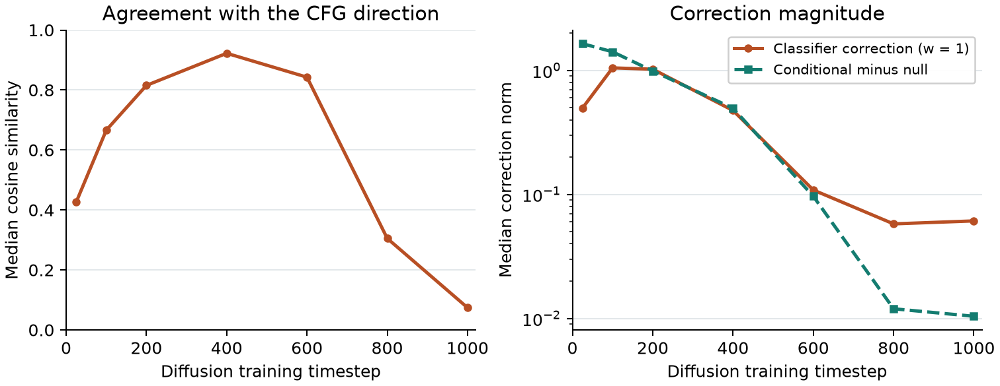
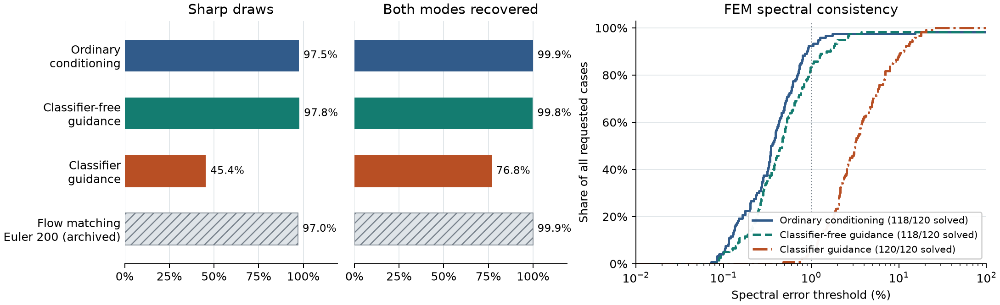
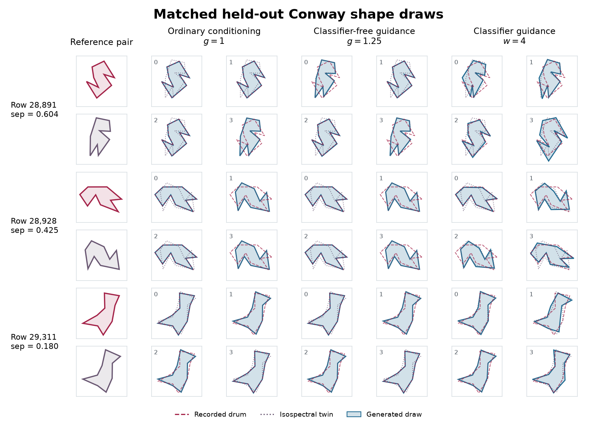
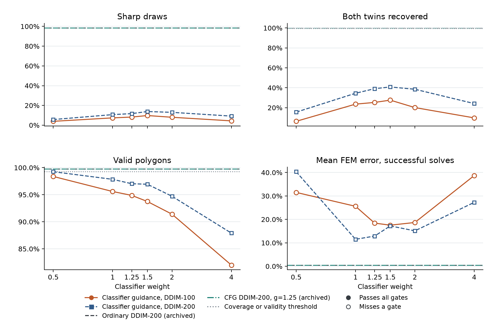
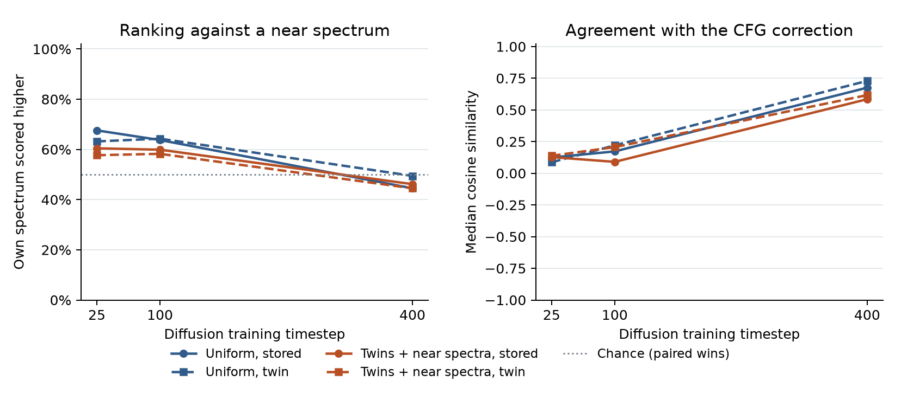

# Classifier-guided diffusion on Conway drums

This experiment asks whether a separately trained shape–spectrum classifier can guide the frozen Conway diffusion prior toward both known isospectral solutions. The comparison uses ordinary conditional diffusion and classifier-free guidance (CFG) from the same [joint checkpoint](cfg_diffusion_experiments.md). The primary outcomes are spectral fidelity, geometric recovery of the two twins, and sampling cost.

**The CFG-matched retraining produced no admissible classifier-guidance setting.** After 40,000 updates, the best sharpness across the 12 validation settings was **13.83%** at 200 steps and `w=1.5`. It recovered both twins on **71/174** separated spectra and had **17.207%** mean FEM error over 117 successful solves. Ordinary DDIM-200 remained the protocol's recommendation, with **98.38%** sharpness, **174/174** two-twin recovery, and **0.506%** mean FEM error over 120 solves. The matched run ended at validation. See the [matched figures and results](#matched-validation-results).

**The compact classifier-guidance pilot failed on the Conway benchmark.** On 1,500 held-out spectra, its strongest validation setting (`w=4`) produced **45.35% sharp draws**, less than half the rate of the earlier flow-matching, conditional-diffusion, and CFG runs. At the same 100-step DDIM budget, classifier guidance recovered both twins for **1,005/1,308** separated pairs, compared with **1,307/1,308** for ordinary conditioning and **1,306/1,308** for CFG. Its median FEM error was **3.187%**, or 9.2 times ordinary conditioning's **0.348%** and 7.1 times CFG's **0.450%**. See the [held-out results and figures](#held-out-comparison).

## Setup

### Data and controls

The Conway main arm contains 27,000 training, 1,500 validation, and 1,500 test spectra. Each row supplies 30 Dirichlet eigenvalues, a randomly selected nine-vertex polygon, and its known twin. The classifier uses the training arm and the diffusion checkpoint's fitted RMS coordinate scale and standardized log-spectrum features. Those features include `log(lambda_1)`, which carries size information. The frozen diffusion model supplies its EMA unconditional prediction during classifier-guided sampling. The conditional and CFG controls use the same EMA weights and target spectra.

These methods build on the earlier [regression and flow matching](isospectral_dataset_experiments.md) and [conditional diffusion](diffusion_dataset_experiments.md) comparisons. The prior produces candidate geometries, while a separate classifier estimates how compatible each intermediate polygon is with a given spectrum.

### Noise-conditioned compatibility classifier

At each sampled timestep `t`, the same centered Gaussian corruption used by the denoiser turns the selected polygon into `x_t`. Balanced logistic training distinguishes pairs `(x_t, c)` from the same row from pairs made with a spectrum and polygon drawn independently. The classifier associates spectra with shapes over the full 1,000-step training grid. Its scalar RingTransformer output is invariant to rigid motions and cyclic or reversed vertex indexing. The clean [triangle pair classifier](../classification/ring_transformer_classifier.py) supplies the architectural precedent.

The population-optimal match logit is `log p_t(c | x_t) - log p(c)`. Its vertex gradient estimates the compatibility term in the conditional score. Logit training estimates this density ratio for the joint and product-of-marginals sampling scheme. [Hermans et al., 2020](https://proceedings.mlr.press/v119/hermans20a.html)

In the epsilon-prediction sampler, a guide strength `w` gives

```text
epsilon_guided = epsilon_null - w * sqrt(1 - alpha_bar[t]) * center(grad_x_t match_logit)
```

`w=0` gives the null prior. `w=1` gives the conditional score with exact population estimates. A larger `w` amplifies the compatibility term and can alter coverage. CFG estimates the corresponding correction as the conditional-minus-null denoiser prediction. Classifier guidance uses a denoiser forward pass, a classifier forward pass, and a classifier input-gradient backward pass at each guided step. [Dhariwal and Nichol, 2021](https://arxiv.org/abs/2105.05233) · [Ho and Salimans, 2022](https://arxiv.org/abs/2207.12598)

### Metrics

The geometry and physical diagnostics follow the CFG study.

- **Nearest-twin error** is the smaller relative vertex error to the labelled polygon or its twin, divided by their separation. Alignment removes translation, rotation or reflection, and cyclic or reversed order, with no fitted scale.
- **Sharpness** counts draws with nearest-twin error below `0.25` of the separation. **Both modes** requires a sharp draw strictly nearer to each twin. Report both for pairs with separation above `0.1`, along with per-spectrum mode balance.
- **Validity** counts finite, nondegenerate simple boundaries among all draws. **FEM error** is the mean absolute relative error over the 30 forward eigenvalues in each successful solve. Report failures and the requested case count alongside the successful-solve mean and median. Remesh both target polygons as numerical controls.
- **Cost** includes denoiser forward calls, classifier forwards and input gradients per draw, and sampling wall time on the same device and batch shape. Report geometry and FEM times separately.

## Pilot validation procedure

1. Inspect classifier binary cross-entropy and discrimination across timesteps on held-out examples. Check both twins against the same stored spectrum at matched noise levels. At the highest noise levels the expected signal approaches chance. The stored FEM spectrum was meshed on the selected twin, so a consistent preference for that twin can reveal use of discretization differences.
2. Use small validation batches to check the sampler, saved geometry arrays, and FEM integration. The [sampler contract tests](test_classifier_guidance.py) check the analytical sign and scale of the correction, bit-identical null draws at `w=0` with matched keys, a sample change from nonzero guidance, and agreement between ordinary and blocked DDPM.
3. Use matched seeds and sampler settings to compare classifier weights with ordinary conditioning and `g=1.25` CFG. The earlier [CFG study](cfg_diffusion_experiments.md#validation-selection) used 200 validation spectra with 16 draws each and selected guidance subject to coverage and validity limits. This pilot used 32 validation spectra with eight draws each and ranked classifier weights by sharpness, both-mode coverage, and median FEM error within the tested range.

The previous CFG report provides historical single-seed references. A CPU pilot and the archived Metal evaluation have different hardware and software timings. A matched runtime comparison requires rerunning the respective inference settings on the same backend.

## Conway validation pilot

The pilot uses a 64-wide RingTransformer with two layers, four attention heads, 32 Fourier timestep features, AdamW at a peak learning rate of `0.001`, and classifier EMA decay `0.995`. Each optimizer update uses 64 matched pairs and 64 independent pairs. Training completed all **10,000 updates** with seed `0` in 283.8 seconds on the Apple M1 Pro CPU with JAX `0.4.38`, Equinox `0.11.12`, and Optax `0.2.4`. It resumed from a checkpoint at update 2,000 on the same optimizer schedule.

### Classifier diagnostics

Each validation bin contains 256 matched and 256 independently paired examples. The twin-pair scores use the same stored spectra and corruption keys as the matched examples. The last two bins are close to the chance AUROC of `0.5` and the chance balanced-logistic loss of `log(2) ≈ 0.693`. At the lowest noise levels, selected and twin mean logits are close, and both generally score as matches.

| Training timestep | BCE | Match AUROC | Selected mean logit | Twin mean logit |
| --- | ---: | ---: | ---: | ---: |
| 1–200 | 0.2393 | 0.9626 | 2.3106 | 2.3204 |
| 201–400 | 0.5692 | 0.7561 | 0.4610 | 0.4425 |
| 401–600 | 0.6773 | 0.5794 | 0.0413 | 0.0446 |
| 601–800 | 0.6930 | 0.5141 | 0.0008 | 0.0020 |
| 801–1,000 | 0.6925 | 0.5183 | 0.0045 | 0.0047 |

### Sampling and forward spectral checks

All six sampler settings used DDIM with 100 steps and `eta=1`, EMA weights, the first 32 validation spectra, and eight draws per spectrum with seed `443`. Of these 32 spectra, 28 meet the separation threshold and contribute 224 draws to the sharpness and mode-balance measures. FEM used the same 12 validation spectra across settings, selected with seed `20261116`, and the first two draws per spectrum.

| Method | Sharp draws | Both modes | Mean nearest-twin error / separation | Mean truth-nearer fraction | Sampling seconds |
| --- | ---: | ---: | ---: | ---: | ---: |
| Ordinary conditioning, `g=1` | 95.09% | 28/28 | 0.05456 | 0.491 | 13.92 |
| CFG, `g=1.25` | 95.09% | 26/28 | 0.05090 | 0.473 | 24.82 |
| Classifier guidance, `w=0.5` | 10.27% | 3/28 | 1.05032 | 0.469 | 18.33 |
| Classifier guidance, `w=1` | 23.21% | 10/28 | 0.55961 | 0.491 | 18.48 |
| Classifier guidance, `w=2` | 37.05% | 16/28 | 0.39451 | 0.496 | 18.12 |
| Classifier guidance, `w=4` | 47.77% | 17/28 | 0.33136 | 0.442 | 18.46 |

| Method | Valid draws | FEM solved | Median FEM error | Mean FEM error | Below 1% / 24 |
| --- | ---: | ---: | ---: | ---: | ---: |
| Ordinary conditioning, `g=1` | 251/256 | 23/24 | 0.486% | 2.008% | 18 |
| CFG, `g=1.25` | 253/256 | 23/24 | 0.395% | 1.926% | 16 |
| Classifier guidance, `w=0.5` | 255/256 | 24/24 | 23.128% | 46.770% | 0 |
| Classifier guidance, `w=1` | 254/256 | 24/24 | 6.824% | 14.202% | 1 |
| Classifier guidance, `w=2` | 254/256 | 23/24 | 3.637% | 10.737% | 0 |
| Classifier guidance, `w=4` | 252/256 | 24/24 | 2.954% | 8.088% | 0 |

FEM means and medians use successful solves. All three failed selected cases were invalid boundaries. The remeshed selected and twin controls both solved for every setting, with median errors of about `0.010%` and `0.012%`. Sampling times include compilation and exclude geometry scoring and FEM. The ordinary, CFG, and classifier-guided settings used 100, 200, and 100 denoiser calls per draw, respectively. The classifier-guided settings also used 100 classifier forwards and 100 input gradients per draw.

Of the four weights in the pilot, `w=4` had the highest sharpness and both-mode coverage and the lowest median FEM error. It still recovered both twins on just 17 of 28 separated spectra, so the held-out run evaluated it as a fixed diagnostic. The AUROC measures discrimination against independently paired spectra. Reconstruction depends on how accurately the logit gradient points toward a compatible shape at each noise level.

An earlier inference smoke check used the 2,000-update classifier, DDIM at 20 steps, four validation spectra, and four draws per spectrum. All 16 `w=0` draws were bit-identical to the `g=0` null draws with matching keys. The 16 `w=1` draws were finite and differed from the null draws. This check confirms that the saved classifier loads and its input gradient reaches the sampler.

### Exploratory checks

Two additional weights were evaluated after the main pilot, using the same validation spectra, draw keys, and FEM subset. At `w=8`, sharpness fell to 20.98% with both modes recovered for 9/28 pairs, 248/256 valid draws, and median FEM error of 22.425% over 23/24 solves. At `w=16`, sharpness fell to 1.34% with 0/28 pairs showing both modes, 226/256 valid draws, and median FEM error of 58.857% over 17/24 solves.

An additional diagnostic compared the classifier epsilon correction at `w=1` and the conditional-minus-null denoiser prediction on identical corrupted states from the first 64 validation spectra, using seed `1729`. Median cosine similarity was `0.426` at `t=25`, with a median classifier-to-denoiser correction norm ratio of `0.319`. At `t=200, 400, 600`, the median cosines ranged from `0.815` to `0.922` and norm ratios from `0.903` to `1.093`. At `t=800` and `t=1000`, cosines fell to `0.305` and `0.074`. The classifier correction norms there were small in absolute terms (about `0.06`), roughly five times the denoiser-difference norms. The denoiser difference serves as a learned reference. These measurements show that agreement varies across the noise schedule. A single guidance weight rescales the correction magnitudes together.



Among the measured timesteps, the unit-weight classifier correction was weakest relative to CFG near the clean end. Agreement in direction also deteriorated at both ends of the schedule. Increasing the weight scales every timestep's correction without changing its direction. This diagnostic compares two learned fields on corrupted validation polygons and gives evidence of where they differ.

## Held-out comparison

The test protocol froze the pilot's strongest classifier setting (`w=4`), the 10,000-update classifier EMA, and the 40,000-update joint diffusion EMA. The controls were ordinary conditioning (`g=1`) and the previously validation-selected CFG strength (`g=1.25`). All three settings used DDIM with 100 steps and `eta=1`, seed `443`, and the same sample keys for 16 draws on each of 1,500 test spectra. Sampling used four spectra per batch. The three settings used the same spectrum preprocessing and geometry thresholds as the pilot.

Geometry and validity used all 24,000 draws per setting. Sharpness and twin-coverage metrics use the 1,308 pairs whose separation exceeds `0.1`, accounting for 20,928 draws. The forward FEM evaluation selected 30 test spectra with seed `20261116` and recomputed the first four draws for each spectrum at the same mesh setting as the CFG study. The 120 requested cases per method enter the failure count and the below-1% denominator. FEM means and medians summarize successful solves. The original polygons and their twins provide numerical controls under the same remeshing.

The CFG control reused the 100-step test draws and archived Metal sampling time from the [CFG study](cfg_diffusion_experiments.md#computation-and-mode-balance). The ordinary and classifier-guided settings used fresh sampling on the same Apple M1 Pro Metal backend. The FEM diagnostics ran on CPU for all three sample sets.



The two geometry panels use 20,928 draws across 1,308 separated pairs. The FEM panel uses all 120 requested cases per method in the denominator, including failed solves. Flow matching is an archived geometry reference at 200 Euler steps.

| Method | Sharp draws | Both modes | Mean nearest-twin error / separation | Mean truth-nearer fraction (SD across spectra) |
| --- | ---: | ---: | ---: | ---: |
| Ordinary conditioning, `g=1` | 97.539% | 1,307/1,308 | 0.03610 | 0.50239 (0.12382) |
| CFG, `g=1.25` | 97.835% | 1,306/1,308 | 0.03732 | 0.50344 (0.12781) |
| Classifier guidance, `w=4` | 45.351% | 1,005/1,308 | 0.35619 | 0.50449 (0.17574) |

The classifier-guided draws recovered one sharp mode on 217 separated spectra and zero sharp modes on 86. The aggregate truth-nearer fraction was close to one half for all three settings. Classifier guidance showed greater variation across individual spectra and substantially lower coverage of the two modes.

| Method | Valid draws / 24,000 | FEM solved / 120 | Median FEM error | Mean FEM error | Below 1% / 120 |
| --- | ---: | ---: | ---: | ---: | ---: |
| Ordinary conditioning, `g=1` | 23,960 | 118 | 0.348% | 0.558% | 111 |
| CFG, `g=1.25` | 23,972 | 118 | 0.450% | 0.633% | 100 |
| Classifier guidance, `w=4` | 23,841 | 120 | 3.187% | 4.817% | 8 |

The four failed selected cases were invalid boundaries. The reference polygons and their twins had median spectral errors of `0.0110%` and `0.0132%` after remeshing. All 120 classifier-guided FEM cases solved, with substantially larger spectral error than the controls. The fixed FEM subset contains 30 conditioning spectra. Its four draws per spectrum share a target.

| Method | Denoiser forwards per draw | Classifier forwards / input gradients per draw | Sampling seconds |
| --- | ---: | ---: | ---: |
| Ordinary conditioning, `g=1` | 100 | 0 / 0 | 280.4 |
| CFG, `g=1.25` | 200 | 0 / 0 | 524.6 (archived) |
| Classifier guidance, `w=4` | 100 | 100 / 100 | 388.5 |

Sampling times include JIT compilation and exclude geometry scoring and FEM. The new classifier-guided run took about 39% longer than the new ordinary run. CFG's time comes from the earlier run on the same backend. These single-seed results measure the fixed classifier and frozen guidance setting on this Conway benchmark.

### Sampled boundaries



The three test spectra are dataset rows 28,891, 28,928, and 29,311, at approximately the 10th, 50th, and 90th percentiles of descending twin-separation rank. Each method shows draws 0–3 over the recorded drum and twin outlines. Each draw is aligned to the reference with the smaller saved vertex error. Alignment removes pose and boundary relabeling while preserving scale. All panels for a given spectrum share the same axis limits.

### Earlier main-ratio baselines

The earlier flow-matching and separately trained conditional-diffusion runs also produced more than twice the fraction of sharp draws of the 100-step classifier-guided run. Their mean nearest-twin errors, normalized by pair separation, ranged from 0.0277 to 0.0665 compared with 0.3562 for classifier guidance. These runs use different training and sampling configurations. Flow-matching provenance relies on the archived split and matching separation statistics. [Flow matching and conditional diffusion comparison](diffusion_dataset_experiments.md#sampler-comparison-50-versus-200-steps)

| Archived main-ratio method | Sampler | Sharp draws | Mean nearest-twin error / separation |
| --- | --- | ---: | ---: |
| Flow matching | Euler 50 | 95.17% | 0.0577 |
| Flow matching | Euler 200 | 96.98% | 0.0509 |
| Conditional diffusion | DDIM 50 | 92.84% | 0.0665 |
| Conditional diffusion | DDIM 200 | 98.76% | 0.0277 |

## CFG-matched settings

The first CG run used 10,000 updates, width 64, two layers, 64 noisy source polygons per update, and classifier EMA decay 0.995. Its validation sweep used 32 spectra and eight draws at 100 DDIM steps. Use the [CFG training settings](cfg_diffusion_experiments.md#training-and-sampling) and [frozen validation procedure](cfg_diffusion_experiments.md#validation-selection) for the matched comparison below.

| Setting | Matched CG configuration |
| --- | --- |
| Training budget | 40,000 updates, 128 noisy source polygons per update |
| Classifier batch | 128 matched pairs and 128 independent pairs, sharing the noisy polygons |
| RingTransformer | Width 256, three layers, four heads, scalar time plus 32 Fourier features |
| Optimizer | AdamW, weight decay `1e-4`, global norm clip `1`, 500-update warm-up to `1e-3`, cosine decay to `1e-6` |
| Classifier weights | Seed `0`, EMA decay `0.999`, EMA for evaluation |
| Dataset and noise | Frozen main-ratio CFG split and preprocessing, centered vertices and noise, 1,000 linear betas from `1e-4` to `0.02` |
| Progress and checkpoints | Validation diagnostics every 1,000 updates, checkpoint every 5,000, training chunks of 100 |

The frozen denoiser supplies its EMA null branch, trained with condition dropout `0.1`. The separate CG classifier receives a spectrum on every pair and estimates the match logit with balanced binary cross-entropy.

Use the first **200 validation spectra**, **16 draws per spectrum**, seed `443`, DDIM with `eta=1` at **100 and 200 steps**, and four spectra per sampling chunk. Evaluate classifier weights `w ∈ {0.5, 1, 1.25, 1.5, 2, 4}`. This grid uses the CFG sweep's nominal scales as anchors and includes the weaker and stronger values from the CG validation pilot. The published CFG optimum `g=1.25` applies to the CFG score difference. The classifier scales its own learned gradient and requires its own validation selection. Use `w=0` for the null-sampler parity check.

For FEM, use 30 fixed validation spectra and their first four draws with seed `20261116` and area/4000 meshing. Use ordinary conditioning at 200 steps as the reference. An eligible candidate must recover both modes for at least **173 of 174** separated spectra, yield at least **3,177 valid draws out of 3,200**, and keep the mean truth-nearer fraction in **[0.47, 0.53]**. Among eligible candidates at each step budget, rank by FEM failures, successful-case mean FEM error, nearest-twin error divided by separation, then smaller weight. Report sharpness alongside those criteria. Keep the ordinary reference as the recommendation if the candidate sweep yields no improvement under the ranking. Record an empty selection if every candidate fails the gates. The first CG pilot's `w=4` result was a diagnostic, with both modes recovered on 17 of 28 separated validation spectra.

### Matched training run

The classifier completed **40,000 updates** on Apple M1 Pro Metal in **3,881.9 seconds of accumulated training worker time**. The JAX Metal backend stalled on the compiled multi-update scan, so the trainer called one compiled optimizer update at a time from the host. The run used 40 stages of 1,000 updates, saving and resuming the optimizer state, EMA weights, and random stream at each checkpoint. The final classifier EMA has SHA-256 prefix `de54c4eedf65`. The dataset, frozen denoiser checkpoint, and preprocessing hashes match the validation protocol in `results/classifier_guidance_cfg_matched/protocol.json`.

Mean training BCE over the final 200 updates was **0.5827**. The EMA classifier's AUROC was **0.9481** on the fixed validation bin at timesteps 1–200 and **0.5234** at 801–1,000. The compact pilot had **0.9626** AUROC at timesteps 1–200 on the same diagnostic pairs. The classifier diagnostic measures discrimination between matched and independently sampled spectra. The sampler comparison below measures whether the resulting gradients guide geometry and spectra.

### Matched validation results

All 12 settings missed both the coverage and validity thresholds. At 100 steps, the strongest sharpness was **9.77%** at `w=1.5`, with both twins recovered on **48/174** separated spectra. At 200 steps, the same weight gave the strongest sharpness of **13.83%**, recovered both twins on **71/174**, and yielded **3,102/3,200** valid draws. The 100-step `w=1.25` setting also missed the mode-balance threshold. The frozen selection returned an empty choice at both step budgets and recommended ordinary DDIM-200. The matched classifier's measurements all came from validation.

The archived ordinary DDIM-200 control reached **98.38%** sharpness, recovered both twins on **174/174** separated spectra, produced **3,193/3,200** valid polygons, and had **0.506%** mean FEM error over 120 successful solves. At the same 100-step budget, the archived ordinary and CFG (`g=1.25`) controls reached **96.70%** and **96.30%** sharpness, respectively. [Archived CFG validation](cfg_diffusion_experiments.md#validation-selection)



The curves cover the same 200 validation spectra at both DDIM step budgets. Hollow markers denote settings that missed at least one gate. The dotted thresholds show the required two-twin coverage and validity. The archived ordinary and CFG reference lines both use 200 steps. The FEM panel shows means over successful solves, with counts reported below.

| DDIM steps | Classifier weight | Sharp draws | Both twins | Valid draws | Mean truth-nearer fraction | Mean nearest-twin error / separation |
| ---: | ---: | ---: | ---: | ---: | ---: | ---: |
| 100 | 0.5 | 3.92% | 11/174 | 3,148/3,200 | 0.4813 | 1.8364 |
| 100 | 1 | 7.40% | 41/174 | 3,059/3,200 | 0.4842 | 1.9501 |
| 100 | 1.25 | 8.23% | 44/174 | 3,036/3,200 | 0.4698 | 2.5650 |
| 100 | 1.5 | 9.77% | 48/174 | 3,000/3,200 | 0.4928 | 27.6990 |
| 100 | 2 | 8.01% | 35/174 | 2,925/3,200 | 0.4759 | 6,272.6631 |
| 100 | 4 | 4.38% | 17/174 | 2,624/3,200 | 0.4767 | 63,722.3203 |
| 200 | 0.5 | 5.71% | 27/174 | 3,176/3,200 | 0.4777 | 1.5337 |
| 200 | 1 | 10.70% | 60/174 | 3,131/3,200 | 0.4777 | 193.8693 |
| 200 | 1.25 | 11.71% | 68/174 | 3,105/3,200 | 0.5083 | 2.5772 |
| 200 | 1.5 | 13.83% | 71/174 | 3,102/3,200 | 0.4864 | 17.1014 |
| 200 | 2 | 13.00% | 67/174 | 3,031/3,200 | 0.4978 | 7,169.6279 |
| 200 | 4 | 9.20% | 42/174 | 2,813/3,200 | 0.4838 | 177,718.7031 |

The untrimmed geometric means include very large draws at high weights. At 100 steps and `w=4`, the median nearest-twin error divided by separation was **1.841** and the maximum was **1.04 × 10⁸**. On 60 of the 2,784 separated-case draws, the relative error exceeded 100 times the separation between the reference twins.

| DDIM steps | Classifier weight | FEM solved | Mean FEM error | Sampling seconds |
| ---: | ---: | ---: | ---: | ---: |
| 100 | 0.5 | 119/120 | 31.513% | 100.7 |
| 100 | 1 | 114/120 | 25.585% | 100.3 |
| 100 | 1.25 | 114/120 | 18.414% | 100.3 |
| 100 | 1.5 | 112/120 | 17.530% | 100.3 |
| 100 | 2 | 113/120 | 18.677% | 100.4 |
| 100 | 4 | 105/120 | 38.713% | 100.3 |
| 200 | 0.5 | 119/120 | 40.340% | 198.6 |
| 200 | 1 | 116/120 | 11.500% | 198.4 |
| 200 | 1.25 | 115/120 | 12.877% | 198.1 |
| 200 | 1.5 | 117/120 | 17.207% | 198.1 |
| 200 | 2 | 114/120 | 15.111% | 198.3 |
| 200 | 4 | 108/120 | 27.265% | 198.6 |

The FEM means use the successful solves on the fixed 30-spectrum subset. Failures count toward the original denominator of 120 attempts. Sampling seconds include compilation on Metal and cover sampling only.

### Matched gradient diagnostic

The correction check reused the compact pilot's first 64 validation spectra, corruption seed `1729`, and timesteps. At timestep 400, the matched classifier's unit-weight correction had median cosine similarity **0.474** with the conditional-minus-null denoiser correction. The compact classifier's cosine at the same timestep was **0.922**. At timestep 25, the matched cosine was **0.205**. At timestep 1,000, it was **0.072** and the median ratio of correction norms was **7.68**. These values compare learned fields on forward-corrupted validation polygons. They quantify disagreement with the reference and leave the cause of the sampling failures open. The frozen selection used the sampler metrics above.

## Lessons from triangle pair classification

The [triangle classification study](../classification/triangle_dataset_experiments.md#which-non-matching-pairs-are-difficult) found most RingTransformer errors in the closest third of mismatched spectra. The Conway pair diagnostic now tests the stored polygon and its isospectral twin with the same supplied spectrum, random substitute, nearby substitute, and corruption keys. For a nearby substitute, the first eigenvalue must differ by at most 1% and the relative L2 distance across all 30 eigenvalues must be between 2% and 5%. The diagnostic measures whether the supplied spectrum receives a higher logit. It also measures the unit CG correction's cosine similarity and norm ratio against the learned CFG correction at the same noisy polygon. Both measurements use validation rows.

### Training with twin positives and nearby proposals

`--include-twins` samples either known polygon of a training row with equal probability and uses that row's supplied spectrum for both. The original pair split stays at the row level. This changes the classifier's empirical shape population. The frozen null denoiser was trained with a randomly selected twin per row, so the two shape populations agree under random twin selection in expectation across datasets.

`--hard-negative-prob` adds a proposal for nearby spectra within the training split. For a row with an eligible list of size \(K_i\), the mixture samples uniformly over the full training split with probability \(1-\rho\), and uniformly over that list with probability \(\rho\). The negative BCE terms receive the weight \((1/N)/q_i(j)\), where \(q_i(j)=(1-\rho)/N+(\rho/K_i)\mathbf{1}_{j\in\mathrm{near}(i)}\). The full mixture probability applies regardless of which branch drew the spectrum. Rows with empty lists use the uniform distribution. This changes which negatives are seen during optimization and keeps the expected independent-negative loss for the chosen positive population. The run stores the neighbor table and checks its hash on resume.

### Matched early comparison

The control uses stored forms and uniform negatives. The second arm samples both twins and uses `--hard-negative-prob 0.5 --hard-neighbors 32`. Both arms use the CFG-matched architecture, batch size, optimizer, and 40,000-update learning-rate schedule with seed `0`. For this early comparison, each arm stops at update 2,000. The single prespecified sampling setting is DDIM-100, `eta=1`, `w=1.5`, seed `443`, and the same 200 validation spectra with 16 draws per spectrum. FEM uses the same 30 spectra and four draws from the full validation protocol. The two changes in the second arm are evaluated together. This comparison gives early training evidence for the two recipes.

The neighborhood rule found eligible training negatives for **26,977 of 27,000** spectrum rows and nearby spectra for **182 of the first 200** validation rows. The two arms used identical diagnostic rows, negative spectra, and noise keys. At `t=100`, the fraction of pairs for which the supplied spectrum beat its near substitute fell from **63.7% to 59.9%** for the stored polygon and **64.3% to 58.2%** for its twin. Median cosine with the learned CFG correction at that step fell from **0.172 to 0.090** for the stored polygon and **0.220 to 0.206** for its twin.



The paired-ranking curves use all 182 eligible validation rows. The correction curves use the first 64 of those rows with the supplied spectrum and the same noise keys.

| Training arm at update 2,000 | Sharp draws | Both twins | Valid draws | FEM solved | Mean FEM error |
| --- | ---: | ---: | ---: | ---: | ---: |
| Stored forms, uniform negatives | 3.81% | 18/174 | 3,181/3,200 | 120/120 | 24.062% |
| Both twins, importance-weighted nearby proposal | 2.33% | 1/174 | 3,191/3,200 | 120/120 | 28.616% |

The combined revision produced ten additional valid polygons along with worse twin recovery, sharpness, and spectral error in this comparison. The results are limited to one seed, one guidance setting, and the 2,000-update checkpoint. The changes to positive shapes and negative proposal were applied together, so the measured differences cannot be attributed to either one separately. The full validation gates remain the criterion for selecting a trained CG model.

## Reproduction

The local pilot archive is `results/classifier_guidance_20261123/`. The final inference weights are in `classifier/classifier.eqx`, with validation bins and training history in `classifier/training.json` and `classifier/history.npz`. The `smoke/` directory holds the initial null-parity check. The `validation/` directory holds matched sampler outputs and one `fem_<prefix>/` directory for each physical check. The `figures/` directory contains geometry plots and sample examples. The additional weights are in `diagnostic/`, and the per-timestep correction comparison is in `gradient_diagnostic.json`. The classifier-guided pilot output names end with the final weights' SHA-256 prefix `5c7b4633d583`.

The held-out archive is `results/classifier_guidance_20261123/full_test/`. `protocol.json` records the frozen settings and input hashes. `archived_cfg_provenance.json` records the origin and hashes of the reused CFG outputs. `comparison.json` contains the matched numerical comparison and the exact FEM row IDs. `outputs/` contains the test samples, metrics, and FEM results. The report figures are stored in [figures/classifier_guidance](figures/classifier_guidance/).

The CFG-matched archive is `results/classifier_guidance_cfg_matched/`. `classifier/` contains the final checkpoint and diagnostics. `validation/` contains the 12 sample archives, geometric summaries, and FEM checks. `protocol.json` records the frozen inputs and thresholds, `selection.json` records the verified results and recommendation, and `gradient_diagnostic.json` contains the correction comparison.

The early pair comparison archive is `results/classifier_guidance_pairs_20261123/`. `diagnostic_protocol.json` records the two configurations and their shared sampling setting. Each arm contains its own checkpoint, samples, FEM check, and `pair_diagnostics.json`. `comparison.json` records the verified comparison.

Start from the repository root and use a Python environment with the project installed. `prior` points to the [trained joint CFG run](cfg_diffusion_experiments.md#files-and-reproduction), with `config.json`, `checkpoint.eqx`, and `preprocessing.npz`. If the data moved, pass `--data` with the path to the same archive. The classifier and evaluation commands verify the dataset and prior identities.

For the staged CFG-matched run, use a fresh classifier directory and resume on the original 40,000-update optimizer schedule. On the local Metal backend, the trainer uses one compiled update per host iteration.

```bash
prior=results/cfg_diffusion_20261116/conway_main_ratio_cfg
guide=results/classifier_guidance_cfg_matched_reproduction/classifier

python training/isospectral/train_classifier.py --prior-run "$prior" --out "$guide" \
  --n-updates 40000 --batch 128 --width 256 --layers 3 --heads 4 \
  --time-features 32 --seed 0 --lr 0.001 --ema-decay 0.999 \
  --eval-every 1000 --checkpoint-every 5000 --train-chunk 100 --stop-after 1000

for stop_after in $(seq 2000 1000 40000); do
  python training/isospectral/train_classifier.py --out "$guide" --resume --stop-after "$stop_after" || exit
done
```

The matched validation sweep uses a separate output directory. For each sampling prefix, run the fixed-row FEM command below with 30 spectra, four draws, and seed `20261116`.

```bash
matched_evaluation=results/classifier_guidance_cfg_matched_reproduction/validation
for steps in 100 200; do
  for weight in 0.5 1 1.25 1.5 2 4; do
    python training/isospectral/diffusion.py --out "$prior" --eval-only \
      --eval-out "$matched_evaluation" --eval-split validation --n-eval 200 \
      --classifier-run "$guide" --classifier-scale "$weight" \
      --n-samples 16 --eval-seed 443 --weights ema --sampler ddim \
      --sampling-steps "$steps" --eta 1 --chunk-size 4 || exit
  done
done
```

The following commands reproduce the original compact pilot checkpoint and sampling.

```bash
prior=results/cfg_diffusion_20261116/conway_main_ratio_cfg
guide=results/classifier_guidance_reproduction/classifier
evaluation=results/classifier_guidance_reproduction/validation

python training/isospectral/train_classifier.py --prior-run "$prior" --out "$guide" \
  --n-updates 10000 --width 64 --layers 2 --heads 4 --batch 64 --seed 0

python training/isospectral/diffusion.py --out "$prior" --eval-only --eval-out "$evaluation" \
  --classifier-run "$guide" --classifier-scale 1 --eval-split validation --n-eval 32 \
  --n-samples 8 --eval-seed 443 --weights ema --sampler ddim --sampling-steps 100 --eta 1

python training/isospectral/diffusion.py --out "$prior" --eval-only --eval-out "$evaluation" \
  --guidance-scale 1 --eval-split validation --n-eval 32 \
  --n-samples 8 --eval-seed 443 --weights ema --sampler ddim --sampling-steps 100 --eta 1
```

Use `--guidance-scale 1.25` for the CFG control. For a classifier sweep, repeat the guided command with each prespecified classifier weight and a separate evaluation directory when changing the number of rows or draws. For the pilot, use `--n-eval 32 --n-samples 8` and run with `JAX_PLATFORMS=cpu .venv-metal/bin/python` in the local pinned environment. Guided filenames encode the classifier weight and the classifier weight file's SHA-256 prefix. Set `prefix` to the saved filename with `_samples.npz` removed.

```bash
python training/isospectral/check_diffusion_spectra.py --run "$evaluation" \
  --evaluation-prefix "$prefix" --n-eval 30 --draws 4 --workers 2 --seed 20261116 \
  --outfolder "$evaluation/fem_$prefix"

python training/isospectral/diffusion_figures.py --run "$evaluation" \
  --out results/classifier_guidance_reproduction/figures
```

For the pilot FEM check, use `--n-eval 12 --draws 2`. `--stop-after` and `--resume` allow staged training on the original optimizer schedule. Evaluation saves draw arrays, per-draw geometry, and a summary with sampler settings, model hashes, and call counts. The FEM checker writes a separate summary, per-case CSV, and recomputed spectra. The figure script makes geometry plots and sample examples. Its historical regression and flow matching rows use the full test split.

For the held-out comparison, set `evaluation` to a fresh test directory. Run the three sampler settings with `--eval-split test --n-eval 1500 --n-samples 16 --chunk-size 4`. Use classifier weight `--classifier-scale 4` and controls `--guidance-scale 1` and `--guidance-scale 1.25`. Apply the 30-spectrum FEM command separately to each test prefix. The original test sampling used `.venv-metal/bin/python` on Metal, while the FEM checker forces CPU inference.

Run the early pair comparison by adding `--stop-after 2000` to the matched training command. For the revised arm add `--include-twins --hard-negative-prob 0.5 --hard-neighbors 32`. Use a fresh output directory per arm. Then run the validation sampler at 100 steps and `--classifier-scale 1.5` and run the same FEM check. To compare the logits and gradients on the fixed pairs, use:

```bash
JAX_PLATFORMS=cpu python training/isospectral/classifier_pair_diagnostics.py \
  --classifier-run "$guide" --gradient-rows 64 --out "$guide/pair_diagnostics.json"
python training/isospectral/classifier_guidance_figures.py \
  --pair-screen results/classifier_guidance_pairs_20261123/comparison.json \
  --out training/isospectral/figures/classifier_guidance
```

Regenerate the figures embedded in this report from the saved test and validation outputs.

```bash
archive=results/classifier_guidance_20261123
figures=training/isospectral/figures/classifier_guidance

python training/isospectral/classifier_guidance_figures.py --run "$archive" --out "$figures"
python training/isospectral/classifier_guidance_examples.py --full-test "$archive/full_test" \
  --out "$figures/held_out_examples.png"

matched_archive=results/classifier_guidance_cfg_matched
python training/isospectral/select_classifier_guidance.py --protocol "$matched_archive/protocol.json" \
  --classifier-run "$matched_archive/classifier" --validation-dir "$matched_archive/validation" \
  --out "$matched_archive/selection.json"
python training/isospectral/classifier_guidance_figures.py --validation-selection "$matched_archive/selection.json" \
  --out "$figures"
```
