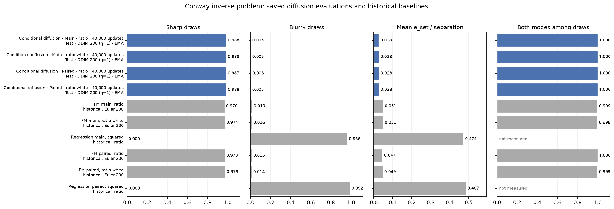
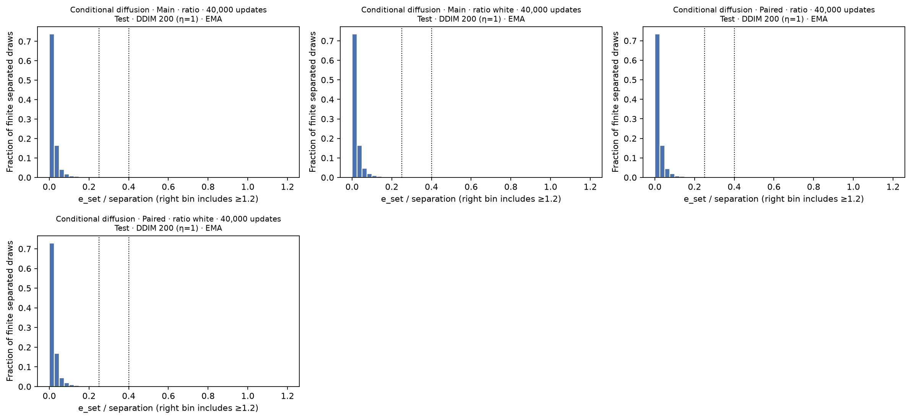
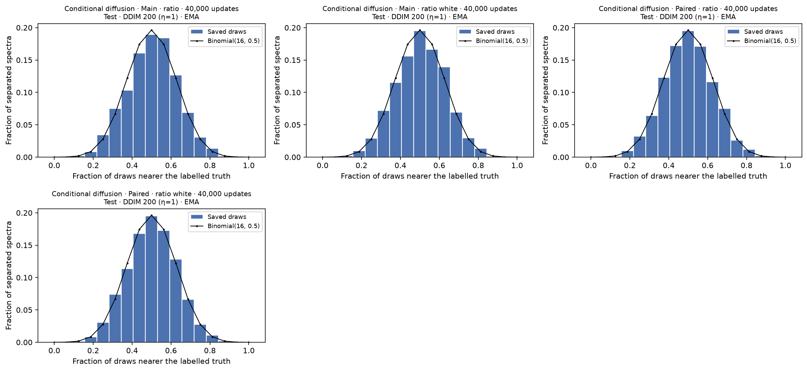
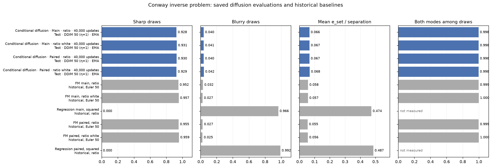
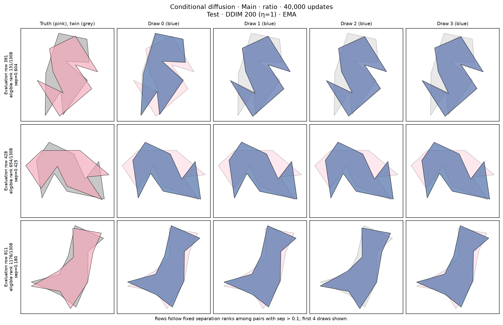

# Isospectral drums: conditional diffusion samples both known solutions

Experiments on 30,000 Conway isospectral drums, extending the [regression and flow-matching study](isospectral_dataset_experiments.md). The question is whether a conditional diffusion model can generate a sharp drum near either known solution, rather than a shape between them. All four configurations were trained for 40,000 updates and evaluated with 16 draws for each of 1,500 test spectra. These are single runs with training seed 0, completed on 12–13 November 2026.

## Summary

* **Diffusion reaches the flow-matching level at 200 sampling steps.** Across the four configurations, 98.70–98.78% of draws are sharp, compared with 96.98–97.56% for the corresponding historical flow-matching runs. Mean distance to the nearest known solution, divided by twin separation, is 0.0277–0.0283 versus 0.0470–0.0509 for flow matching.
* **Both known modes are represented.** Every one of the 1,308 separated test pairs has at least one sharp draw nearer each of its two drums among the 16 samples. The mean fraction nearer the labelled truth is 0.5009–0.5043; its spread over spectra is close to the 0.125 reference for 16 independent 50/50 draws. This supports balanced sampling, without establishing exact posterior calibration.
* **Averaging the samples loses the useful ambiguity.** Although individual draws are sharp, 56.1–59.5% of their Procrustes means are blurry. A mean shape is a poor summary of the two distinct solutions in this experiment.
* **The sampling budget matters.** At 50 steps diffusion produces 92.84–93.14% sharp draws and trails the corresponding flow-matching results, 95.17–95.89%. The 200-step result should not be presented as superiority at every sampling budget.
* **Forward physics checks support approximate spectral consistency.** Median 30-eigenvalue relative errors are 0.418–0.467% among successful solves on a fixed random subset. There are substantial outliers, and one of the 480 requested generated polygons is invalid.
* **Paired labels and whitening make little difference in these runs.** All four 200-step results are similar. More seeds are needed to distinguish small differences.

## Setup

### Data and arms

The dataset is generated by [generate_data.py](generate_data.py) using seed 2026: 30,000 rows, nine boundary vertices per drum and 30 finite-element eigenvalues. Each row stores a labelled drum and its Conway twin. This gives two known solutions to the inverse problem; it does not establish that these are the only polygons with the supplied finite spectrum.

The first 27,000 source rows are used for training, the next 1,500 for validation, and the last 1,500 for testing. Twins are added **after splitting**, so a test twin is never introduced into the training set through the paired arm.

| Arm | Training pairs | Labels |
|---|---:|---|
| Main | 27,000 | The stored drum, with its domain chosen by the data sampler |
| Paired | 54,000 | Both the stored drum and its twin, conditioned on the same stored spectrum |

Each arm is trained with `ratio` and `ratio_white` conditioning. `ratio` standardises log(lambda_k / lambda_1), k = 2,...,30, and log lambda_1. `ratio_white` additionally applies PCA whitening. All feature statistics are fitted on training rows only. There is no new control-arm diffusion experiment; the earlier canonical-label regression control remains contextual evidence.

Coordinates are centred and divided by one training-derived scalar,

$$
s = \sqrt{\frac{\mathbb{E}_{\mathrm{train}}\|V-\overline V\|_F^2}{2(9-1)}}
  = 1.3137899637.
$$

The same scalar is used for every shape and both twins; individual shapes are not rescaled to unit size. This preserves the size information carried by the spectrum. The training-derived scale is restored before forward FEM evaluation.

The regenerated dataset's SHA256 is
`083eaca4cae5acc272f1f434f5627600f03820f623cf0b683b42253e9a6edad2`.
The historical FM summaries have no dataset hash. Their split and geometry fingerprints match: 1,308 test pairs with separation above 0.1, and mean separation 0.41279810667037964 over those pairs. Bitwise equality of the historical spectral arrays cannot be verified from the committed summaries.

### Model and training objective

The implementation is [src/drums/models/diffusion.py](../../src/drums/models/diffusion.py), with the Conway experiment runner in [diffusion.py](diffusion.py). The noise predictor uses the same ring-transformer backbone family as the flow-matching velocity predictor: width 256, three layers and four attention heads. It predicts a centred two-dimensional noise vector at each of the nine vertices, conditioned on spectral features, a scalar time and 32 sinusoidal time features.

For a centred, scaled shape x_0, training draws a uniform integer t from 1,...,1,000 and uses

$$
\epsilon = Pz,\qquad z\sim\mathcal N(0,I),\qquad
x_t=\sqrt{\bar\alpha_t}\,x_0+\sqrt{1-\bar\alpha_t}\,\epsilon,
\qquad
\mathcal L=\mathbb E\left[\frac1{18}\|\epsilon_\theta(x_t,t,c)-\epsilon\|_F^2\right],
$$

where P subtracts the vertex mean, c is the spectral condition, alpha_t = 1 - beta_t and bar(alpha)_t is their cumulative product. The Gaussian lives in the 16-dimensional centred-coordinate subspace. Both the corruption noise and predictor output are centred. The ring predictor retains rotation/reflection and dihedral vertex-order equivariance.

There is no noise-dependent alignment of x_0 to epsilon in the diffusion corruption. The corruption uses the stated Gaussian kernel; the noise-aligned pairing of the FM experiment is a different construction. The optional Gaussian-skip branch is disabled in all four reported Conway models.

| Setting | Value |
|---|---|
| Training updates / batch size | 40,000 / 128 in both arms |
| Optimizer | AdamW, weight decay 1e-4, gradient norm clipping at 1 |
| Learning rate | 500-update warm-up to 1e-3, cosine decay to 1e-6 |
| Forward noise schedule | 1,000 steps, beta linearly increasing from 1e-4 to 0.02 |
| Time features | Scalar t / 1,000 plus 32 sinusoidal features |
| Evaluation weights | Exponential moving average, decay 0.999 |
| Training / evaluation seeds | 0 / 443 |
| Draws / test spectra | 16 / 1,500 |
| Final sampler | Stochastic DDIM, eta = 1, with 50 or 200 steps |

The **1,000-step training schedule and 50/200-step sampling budgets are different quantities**. DDIM selects times from the original schedule; these results do not come from retraining a 50- or 200-noise-step DDPM. Each reported sampling step uses one noise-predictor evaluation. Native full-schedule DDPM sampling is also implemented, but it was not evaluated on the full Conway test suite.

EMA weights and eta = 1 were selected using 200 validation spectra from the main-ratio run, then frozen before its test evaluation and applied to the other configurations. The 50-step evaluation uses that same frozen choice. The saved validation sharpness for the selected 200-step protocol was 98.10%, with e_set/sep = 0.0333 and both modes present for every separated validation pair.

The comparison with historical FM matches data-generation settings, splits, width, layers, batch size, retained update budget and twin metrics. It is **not an isolated change of training objective**: diffusion also uses RMS coordinate scaling, sinusoidal time features and EMA, while historical FM used maximum-radius scaling, scalar time and raw weights. The results compare these implemented configurations.

### Metrics

Metrics use [common.py](common.py) and [metrics.py](metrics.py). Alignment removes translation, rotation/reflection and the 18 cyclic/reversed vertex orderings, while preserving size. The relative vertex error d(target, prediction) uses target vertex norms in its denominator and is asymmetric.

For each generated drum p, labelled truth y and known twin y', define e_truth = d(y,p), e_twin = d(y',p), e_set = min(e_truth,e_twin) and sep = d(y,y').

* **error** is mean e_truth over all 1,500 spectra and their 24,000 draws.
* **e_set** in the tables is the mean nearest-twin error over the separated group, matching the saved `error_set` field.
* **e_set/sep** is the mean of the per-draw ratios for pairs with sep > 0.1. Smaller values indicate closer proximity to a known solution.
* **Sharp** means e_set/sep < 0.25; **blurry** means e_set/sep > 0.40. These are tolerance-based geometric labels, not exact equality to a drum or its spectrum.
* **mid/sep** is the distance to the aligned truth/twin midpoint, divided by separation. **pick** is the fraction of sharp draws nearer the labelled truth.
* **Mode balance** counts all draws nearer each known drum. **Both modes** requires at least one **sharp** draw strictly nearer each drum. These geometric tolerances do not assert exact shape or spectral recovery.
* **Mean of draws** uses an iterative Procrustes mean computed from generated samples only, without using the true drum to construct the mean.

There are **1,308 separated spectra**, giving **20,928 separated draws** per evaluation. Sharpness, blurriness, set/separation ratios and mode-balance summaries use this group. Overall truth error uses all spectra. For an exact 50/50 twin sampler, the expected truth error on the separated group is approximately 0.2064, despite zero nearest-twin error; selecting the other correct solution is penalised by a one-label error metric.

The legacy energy diagnostic is retained in the result files for comparability. Its proper-scoring-rule interpretation in the earlier report does not hold for this asymmetric distance; see the dedicated discussion below.

## Results

### Individual draws at 200 sampling steps

Fractions are displayed as percentages. `error` uses the full test set; all other columns below use the separated group, with `pick` further restricted to sharp draws.

| Run | error, all test | e_set, separated | sharp | blurry | e_set/sep | mid/sep | pick |
| --- | --- | --- | --- | --- | --- | --- | --- |
| main, `ratio` | 0.1866 | 0.0088 | 98.76% | 0.47% | 0.0277 | 0.4984 | 0.5041 |
| main, `ratio_white` | 0.1870 | 0.0088 | 98.78% | 0.53% | 0.0281 | 0.4986 | 0.5034 |
| paired, `ratio` | 0.1880 | 0.0091 | 98.70% | 0.60% | 0.0283 | 0.4987 | 0.5009 |
| paired, `ratio_white` | 0.1877 | 0.0090 | 98.76% | 0.49% | 0.0283 | 0.4986 | 0.5016 |

Sharpness improves over every corresponding historical FM-200 result, while e_set/sep falls from approximately 0.047–0.051 to 0.028. The four diffusion results are very similar; differences of a few hundredths of a percentage point should not be treated as established improvements between configurations.



Blue bars are diffusion; grey bars are committed historical FM/regression results. Both generative methods use 200 predictor evaluations per draw. No historical baseline was retrained for this comparison.



These distributions use all separated draws. Vertical lines mark the sharp/blurry thresholds; the rightmost bin includes ratios at or above 1.2.

### Mode balance and the mean of the draws

| Run | Mean fraction nearer truth | SD over spectra | Both modes, sharp draws among 16 |
| --- | --- | --- | --- |
| main, `ratio` | 0.5041 | 0.1300 | 1,308 / 1,308 |
| main, `ratio_white` | 0.5043 | 0.1293 | 1,308 / 1,308 |
| paired, `ratio` | 0.5009 | 0.1273 | 1,308 / 1,308 |
| paired, `ratio_white` | 0.5009 | 0.1269 | 1,308 / 1,308 |

The standard-deviation reference for 16 independent Bernoulli(0.5) assignments is sqrt(0.25/16) = 0.125. Observed means and spreads are close to this reference. With 16 exact independent 50/50 draws, the probability of missing one mode is 2 / 2^16, so observing both modes in all 1,308 cases is compatible with the reference. These summaries do not prove calibration for every condition or identify other possible solutions.



Taking the Procrustes mean of the 16 draws gives:

| Run | error, all test | e_set/sep | sharp | blurry | mid/sep |
| --- | --- | --- | --- | --- | --- |
| main, `ratio` | 0.1915 | 0.4087 | 4.43% | 57.49% | 0.1098 |
| main, `ratio_white` | 0.1922 | 0.4088 | 4.51% | 56.12% | 0.1089 |
| paired, `ratio` | 0.1929 | 0.4111 | 4.74% | 59.48% | 0.1084 |
| paired, `ratio_white` | 0.1925 | 0.4105 | 4.28% | 57.72% | 0.1075 |

The average often lies between the known solutions, even when its constituents are individually sharp. This reproduces the distinction seen with flow matching: preserve the samples when the goal is to express ambiguity.

### Sampler comparison: 50 versus 200 steps

| Run | Steps | Diffusion sharp | Diffusion blurry | Diffusion e_set/sep | FM sharp | FM e_set/sep |
| --- | --- | --- | --- | --- | --- | --- |
| main, `ratio` | 50 | 92.84% | 4.03% | 0.0665 | 95.17% | 0.0577 |
| main, `ratio` | 200 | 98.76% | 0.47% | 0.0277 | 96.98% | 0.0509 |
| main, `ratio_white` | 50 | 93.14% | 4.09% | 0.0671 | 95.65% | 0.0572 |
| main, `ratio_white` | 200 | 98.78% | 0.53% | 0.0281 | 97.39% | 0.0506 |
| paired, `ratio` | 50 | 92.96% | 4.00% | 0.0665 | 95.53% | 0.0550 |
| paired, `ratio` | 200 | 98.70% | 0.60% | 0.0283 | 97.31% | 0.0470 |
| paired, `ratio_white` | 50 | 92.85% | 4.25% | 0.0681 | 95.89% | 0.0564 |
| paired, `ratio_white` | 200 | 98.76% | 0.49% | 0.0283 | 97.56% | 0.0485 |

Increasing the diffusion sampling budget substantially reduces geometric error: mean e_set/sep drops from 0.066–0.068 to about 0.028. Historical FM changes less over the same budgets. Thus diffusion leads on these geometric metrics at 200 evaluations and trails FM at 50; there is no universal ranking from this experiment. This is an evaluation-count comparison, not a wall-clock benchmark.



### Comparison with regression on the main arm

| Method, main arm, ratio features | error, all test | e_set/sep | sharp | blurry |
| --- | --- | --- | --- | --- |
| Regression, relative loss | 0.1613 | 0.3250 | 18.58% | 22.25% |
| Regression, squared loss | 0.1865 | 0.4739 | 0.00% | 96.56% |
| FM, Euler 200 | 0.1917 | 0.0509 | 96.98% | 1.87% |
| Diffusion, DDIM 50 | 0.1920 | 0.0665 | 92.84% | 4.03% |
| Diffusion, DDIM 200 | 0.1866 | 0.0277 | 98.76% | 0.47% |
| Diffusion, mean of 16 DDIM-200 draws | 0.1915 | 0.4087 | 4.43% | 57.49% |

Regression with relative loss has a lower error against the single labelled truth, while its output is much less often close to either known solution. A successful generative draw can instead be the other valid drum. The nearest-twin and mode summaries expose this distinction; truth error alone does not.



Truth is pink, twin grey and generated draw blue. The three cases are fixed at approximately the 10th, 50th and 90th percentiles of descending twin separation among eligible pairs, and always show draws 0–3. Dataset IDs are 28891, 28928 and 29311. Cases and draws were not selected by generated quality; alignment for display fits no scale. Exact selection metadata are in [provenance_200.json](figures/diffusion/provenance_200.json).

### Forward spectral consistency

[check_diffusion_spectra.py](check_diffusion_spectra.py) checks the generated polygons independently of distance to the known twins. First, a cheap finite/nondegenerate/simple-boundary test is applied to all 24,000 saved 200-step draws per model. This is a geometry validity check, not 24,000 FEM solves.

For the physical check, 30 of the 1,500 test spectra are selected uniformly without replacement with seed 20261112. The same rows are used for every model, taking their first four draws: 120 requested generated cases per model. Selection does not depend on validity or error. Each target and twin is also remeshed as a control.

The predicted polygon is restored to physical scale without fitting to the reference spectrum. The forward solver uses 4,000 target mesh elements and computes 30 eigenvalues. For a successful solve, the spectral mean absolute relative error is

$$
\operatorname{MARE}(p)=\frac1{30}\sum_{k=1}^{30}
\left|\frac{\lambda_k^{\mathrm{FEM}}(p)}{\lambda_k^{\mathrm{input}}}-1\right|.
$$

| Run | Valid saved polygons | Validity | FEM successes | MARE < 1%, all requested |
| --- | --- | --- | --- | --- |
| main, `ratio` | 23,988 / 24,000 | 99.95% | 120 / 120 | 97 / 120 |
| main, `ratio_white` | 23,981 / 24,000 | 99.92% | 120 / 120 | 100 / 120 |
| paired, `ratio` | 23,991 / 24,000 | 99.96% | 120 / 120 | 92 / 120 |
| paired, `ratio_white` | 23,982 / 24,000 | 99.92% | 119 / 120 | 96 / 120 |

The below-1% counts retain all 120 requested draws in their denominator, including invalid cases. No solver errors occurred. The paired-whitened failure is a self-intersecting polygon at test row 190, dataset ID 28690, draw 2. Across models there are 479 successful generated solves out of 480 requests, from the same 30 target groups; these are not 480 independent conditioning cases.

| Run | Mean MARE, successes | Median MARE, successes | Maximum MARE, successes |
| --- | --- | --- | --- |
| main, `ratio` | 1.204% | 0.418% | 43.34% |
| main, `ratio_white` | 0.832% | 0.467% | 15.89% |
| paired, `ratio` | 0.898% | 0.467% | 10.24% |
| paired, `ratio_white` | 0.778% | 0.454% | 13.92% |

Mean, median and maximum spectral errors use successful solves only: 120 cases for the first three rows and 119 for the last. All outliers remain included. The main-ratio maximum is at dataset ID 28634, draw 3; the other maxima are at dataset ID 28690, draw 1. The latter condition is repeatedly difficult across models.

Target and twin controls each solve 30/30 cases per model. Their mean MAREs are approximately 0.01116% and 0.01239%, respectively, much smaller than generated-shape errors. The typical generated spectrum is close to the input, but errors have a tail: the 43.34% maximum and invalid case preclude a claim of exact or uniformly accurate spectral recovery. No matching forward-FEM benchmark of historical FM draws is available, so these checks do not establish better physical accuracy than FM.

### Legacy energy diagnostic

For compatibility with the earlier study, the saved files include

$$
S(Q,y)=\mathbb E_{X\sim Q}d(y,X)
       -\tfrac12\mathbb E_{X,X'\sim Q}d(X,X'),
$$

estimated from distinct sample pairs. Lower values are shown here as diagnostics only.

| Run, 200 steps | Diffusion legacy diagnostic | FM legacy diagnostic |
| --- | --- | --- |
| main, `ratio` | 0.092820 | 0.086389 |
| main, `ratio_white` | 0.093106 | 0.087428 |
| paired, `ratio` | 0.093733 | 0.086759 |
| paired, `ratio_white` | 0.093630 | 0.086919 |

**This implementation is not a proper scoring rule for the chosen asymmetric d.** For an exact two-point target distribution with equal probabilities on T and W, let a = d(T,W), b = d(W,T), and let a forecast put probability q on T. Ignoring negligible numerical self-distances, its expected score is

$$
R(q)=\frac a2-aq+\frac{a+b}{2}q^2,
\qquad q_* = \frac{a}{a+b}.
$$

When a differs from b, this rewards a forecast probability different from the true 1/2. For example, an audited test pair has a = 0.915129 and b = 0.654727, giving q_* = 0.582938. The earlier report's general properness claim therefore needs this correction.

FM has the lower legacy value in all four comparisons, while diffusion has the better nearest-twin geometric metrics at 200 steps. Neither ranking should be hidden, and the energy difference should not be interpreted as proof that FM has a better calibrated posterior. Asymmetry also does not, by itself, explain the entire observed score gap. Raw historical FM draws are unavailable for a full sample-level audit.

## Conclusions

1. **A denoising diffusion model can represent the known ambiguity in this dataset.** At 200 steps, about 98.7–98.8% of draws are geometrically close to a known solution, and the samples represent both drums with approximately balanced assignments.
2. **The model's regression target differs from a direct shape regressor's.** The network regresses noise conditional on a noisy shape, time and spectrum. Iterative sampling generates a distribution of shapes; it does not directly return one averaged shape for the spectrum.
3. **Keeping samples matters.** Averaging them produces blurry geometry for more than half of the separated cases, despite sharp individual draws.
4. **The sampler is part of the result.** The 200-step stochastic DDIM configuration reaches and exceeds the historical FM geometric metrics; the same trained model with 50 steps does not. Neither result establishes superiority of diffusion as a class.
5. **Adding both twins or whitening the condition has little effect in these single runs.** Main and paired arms, and both feature sets, produce nearly identical 200-step geometric scores.
6. **The forward check adds physical evidence and reveals failures.** Typical spectral discrepancies are small, but the error tail and one invalid selected boundary remain important limitations.

## Caveats

* One training seed per configuration and 16 draws per condition. Pooled draws are grouped by spectrum; they should not be treated as independent evidence for a very precise method ranking.
* Sharpness depends on the chosen thresholds and on the constructed twin pair. Recovering one known twin approximately is not the same as enumerating every solution compatible with 30 eigenvalues.
* The relative vertex discrepancy is asymmetric and has a target-dependent per-vertex normalization. The legacy energy expression is not a proper probability score for this discrepancy.
* Historical baselines were reused, not rerun. Diffusion changes normalization, time features, EMA and sampling as well as the learning objective. A controlled ablation is needed to attribute the gain.
* The final test suite uses stochastic DDIM with eta = 1; it is not a full 1,000-step DDPM test or a deterministic eta = 0 DDIM test.
* Forward spectra were checked only for a fixed 30-condition subset of 200-step draws, at one mesh resolution. Geometry validity on all saved draws is a separate, cheaper test. Invalid cases stay in failure and threshold-rate denominators, while spectral averages are success-only.
* The Conway results use JAX 0.4.38, Equinox 0.11.12 and Optax 0.2.4. Main models trained on Metal; paired-ratio updates 0–20,000 and paired-whitened updates 0–5,000 ran on CPU before GPU resumption. GPU training used fresh processes every 5,000 updates, with saved optimizer state and PRNG keys. Stalled segments were restarted from saved checkpoints. Recorded training times are not a fair wall-clock comparison to FM, and CPU/GPU execution is not claimed to be bitwise identical.

## Suggested further research

1. Repeat several training and sampling seeds; assess variation at the spectrum level.
2. Match scaling, time representation and EMA between diffusion and FM to separate their contributions from the objective.
3. Improve the 50-evaluation sampler using validation data before a new held-out comparison.
4. Investigate repeated hard condition 28690, the largest spectral outlier, and mechanisms for maintaining a simple polygon boundary.
5. Expand the forward check to more conditions and mesh resolutions, and evaluate FM draws under the same protocol.
6. Study higher-dimensional and approximate ambiguity, including the perturbed GWW family; assess probability calibration with a validated proper score or an explicit mode-probability test.

## Reproducing

Run from the repository root with an environment containing the package and training dependencies. The reported accelerator runs used `.venv-metal/bin/python`; the FEM checker runs in a separate CPU process. Existing raw runs are under `results/isospectral_diffusion_20261112/`; the commands below use a fresh output directory.

Generate the data if it is absent:

```bash
python training/isospectral/generate_data.py --n 30000 --workers 6 --chunk 100 --seed 2026 \
  --out training/isospectral/isospectral_30k.npz
```

Train and evaluate all four configurations with the frozen settings:

```bash
for arm in main paired; do
  paired_args=()
  if [ "$arm" = paired ]; then paired_args=(--paired); fi
  for features in ratio ratio_white; do
    run="results/diffusion_reproduction/conway_${arm}_${features}"
    python training/isospectral/diffusion.py \
      --data training/isospectral/isospectral_30k.npz --out "$run" \
      --features "$features" "${paired_args[@]}" \
      --coordinate-scale rms --time-features 32 --ema-decay 0.999 \
      --N-f 256 --L 3 --n-heads 4 --batch 128 --lr 0.001 --seed 0 \
      --n-steps 1000 --beta-start 0.0001 --beta-end 0.02 \
      --n-updates 40000 --stop-after 5000 --train-only \
      --eval-every 1000 --checkpoint-every 5000
    for limit in 10000 15000 20000 25000 30000 35000 40000; do
      python training/isospectral/diffusion.py --out "$run" \
        --resume --stop-after "$limit" --train-only
    done
    for steps in 50 200; do
      python training/isospectral/diffusion.py --out "$run" --eval-only \
        --eval-split test --eval-seed 443 --n-eval 1500 --n-samples 16 \
        --chunk-size 4 --weights ema --sampler ddim --sampling-steps "$steps" --eta 1
    done
    JAX_PLATFORMS=cpu python training/isospectral/check_diffusion_spectra.py \
      --run "$run" --evaluation-prefix test_ddim200_ema_eta1 \
      --n-eval 30 --draws 4 --workers 2 --seed 20261112 \
      --outfolder "$run/fem_test200"
  done
done
```

`--stop-after` is an absolute stage boundary; it leaves the original 40,000-update learning-rate schedule intact. The examples explicitly use the frozen configuration, rather than the runner's simpler defaults.

Collect comparisons and regenerate plots:

```bash
python training/isospectral/collect_diffusion_results.py \
  --root results/diffusion_reproduction

for steps in 50 200; do
  python training/isospectral/diffusion_figures.py \
    --run results/diffusion_reproduction/conway_main_ratio \
    --run results/diffusion_reproduction/conway_main_ratio_white \
    --run results/diffusion_reproduction/conway_paired_ratio \
    --run results/diffusion_reproduction/conway_paired_ratio_white \
    --evaluation-prefix "test_ddim${steps}_ema_eta1" --baseline-steps "$steps" \
    --out "results/diffusion_reproduction/figures${steps}"
done

python -m unittest discover -s tests -p 'test_diffusion*.py' -v
```

The completed implementation/experiment test run passed 19 tests. Data, weights and raw sample arrays are not committed; the compact result JSONs and report figures are stored with this report. The local run archive additionally contains per-draw arrays, FEM spectra/cases, configuration and data hashes, the frozen protocol, source snapshots and an artifact manifest.

## Saved results and preliminary triangle check

| Run | Saved result |
| --- | --- |
| main, `ratio` | [diffusion_main_ratio.json](summary/diffusion_main_ratio.json) |
| main, `ratio_white` | [diffusion_main_ratio_white.json](summary/diffusion_main_ratio_white.json) |
| paired, `ratio` | [diffusion_paired_ratio.json](summary/diffusion_paired_ratio.json) |
| paired, `ratio_white` | [diffusion_paired_ratio_white.json](summary/diffusion_paired_ratio_white.json) |

Each Conway JSON includes both sampling budgets, training/evaluation metadata, matched FM differences and the FEM summary. Figure provenance is saved in [provenance_200.json](figures/diffusion/provenance_200.json) and [provenance_50.json](figures/diffusion/provenance_50.json). Historical comparators are `summary/fm_<arm>_<features>.json` and the regression summaries used above.

Before the Conway suite, a triangle sanity run used 900 training shapes and 100 held-out validation shapes, width 256, three layers, 20,000 updates, seed 17, RMS scaling and 32 time features. This was a development check, not an independent final-test benchmark or a matched FM comparison.

| Sampler, raw triangle weights | Draws per condition | Mean relative draw error | Relative error of the Procrustes mean |
|---|---:|---:|---:|
| DDPM, full 1,000 steps | 16 | 0.03469 | 0.01724 |
| DDIM, 200 steps, eta = 0 | 32 | 0.03952 | 0.01773 |

Triangle errors are mean per-vertex relative discrepancies after checking all six triangle labelings and optimal rotation/reflection, without fitting scale. The Conway evaluator checks its 18 dihedral orderings. On this sanity set averaging reduces error; on the ambiguous Conway pairs it often blurs between solutions. The historical triangle FM reference had lower errors (0.01527 per draw and 0.00873 for the mean), with a different run/sampling protocol, so the triangle check should not be described as reaching that reference. Its saved summaries are [DDPM](../diffusion/summary/triangle_ddpm1000.json) and [DDIM](../diffusion/summary/triangle_ddim200.json).
