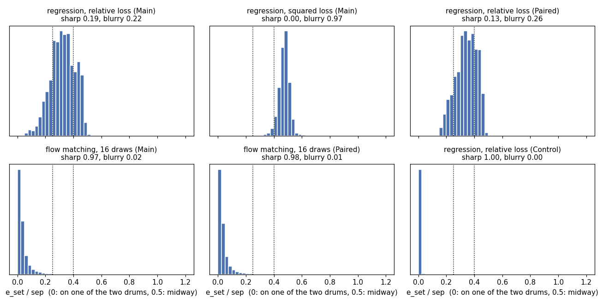
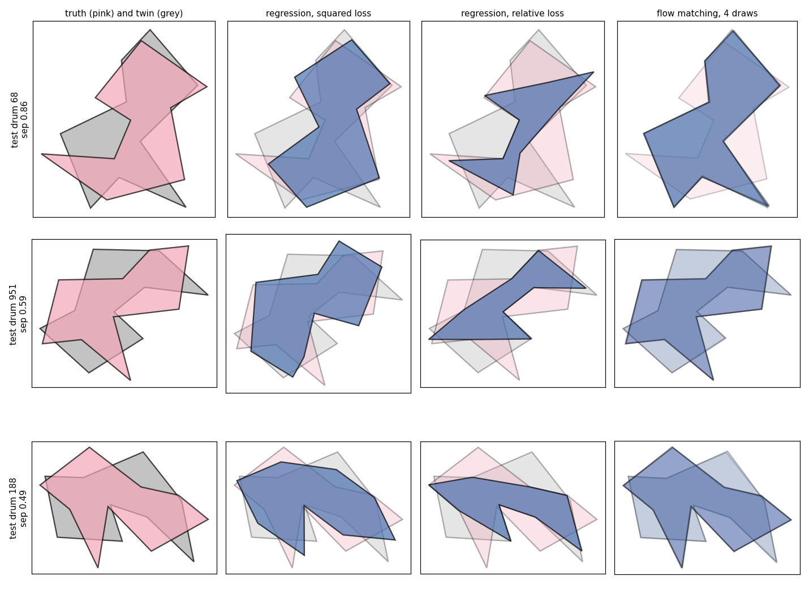

# Isospectral drums: regression and flow matching when the spectrum has two drums

Experiments on the `isospectral_drums` dataset (`drums.data.isospectral_drums`, 30,000 drums): for every spectrum there
are exactly two drums, the sample and its isospectral twin. We look at what regression and flow matching do with such a
label. All numbers are single runs (one seed). Code and raw results are in this folder
(the metrics of every run are in `summary/*.json`); figures: `figures/fig_sharpness.png`, `figures/fig_examples.png`.

## Summary

* **The ambiguity is the only thing that breaks regression.** On the same 30k spectra the same network reaches a
  relative vertex error of 0.0022 when the label is made a function of the spectrum
  (control arm), and 0.161 when the label is one of the two drums of the pair at
  random (main arm), about 73 times worse.
* **Regression blurs, flow matching does not.** With the squared loss the regression outputs a shape close to the midpoint
  of the two drums (97% of the predictions are blurry); with the relative loss it gives a distorted
  blend, sharp for 19% and blurry for 22% of the drums.
  The draws of flow matching are on one of the two drums for 97% of the cases, and their split
  between the two drums is consistent with 50/50 for every spectrum, as for the exact posterior.
* **The error against the truth cannot tell them apart.** A sharp predictor that picks a twin at random has the error
  0.21, a blurry one has about the same, so the numbers that matter are the distances to the
  nearest twin and the energy score (below).
* **Adding the twins to the training set changes nothing** (paired arm): the label distribution of every spectrum is the same.

## Setup

**Data.** `isospectral_30k.npz` (`python generate_data.py --n 30000 --seed 2026`, deterministic, 30,000 drums, 11 min on 16 workers, default sizes `r_min=0.25`, `r_max=1.5`; the
vertices of the drums are up to 4.7 from the centroid, more than in the other datasets). Keys: `perimeters` (9 vertices), `spectra`
(30 eigenvalues), `domain`, `twin_perimeters`. The first 27,000 samples are the training set, then 1,500 for validation and
1,500 for test. The spectra are finite-element eigenvalues with the mesh of the generator, so they are 0.4-1.6% above the
exact ones, which is irrelevant for the comparison.

**Arms** (the spectra are the same in all of them, only the training labels differ; the test spectra are the same):

| Arm | training pairs | what is tested |
|---|---|---|
| **Main** | 27,000 (spectrum, `perimeters`): one drum of the pair, chosen at random by the sampler | the realistic ambiguous data: the same spectrum region is paired with drum A in some samples and with drum B in others |
| **Paired** | 54,000: (spectrum, `perimeters`) and (the same spectrum, `twin_perimeters`) | the same ambiguity made explicit, both drums of every training pair are present |
| **Control** | 27,000 (spectrum, canonical drum) | no ambiguity: the label is a function of the spectrum, so a good model must reach a small error |

*Canonical drum.* The index `domain` is not a property of the shape: the corners (T0, T1, T2) of the base triangle are
labelled at random by the sampler and relabelling T0 <-> T2 gives the same two polygons with the names exchanged (checked numerically).
The canonical drum is the first polygon of the labelling with angle(T0) >= angle(T2): for every sample the labelled triangle is
recovered from its polygon (`make_single_domain.py`), the stored drum is kept if it is canonical (15,030 of 30,000 samples) and replaced by its twin otherwise.
The rule is continuous in the shape (for equal angles the two polygons are congruent). A first version of the control, "always
domain 0", was wrong for the reason above and was discarded.

**Methods.**
* *Oracle nearest training shape*: the training drum closest to the true test drum; it uses the answer and shows how well the training set covers the shape family.
* *Spectral kNN* (k = 1, 5, 20) in several feature spaces; the neighbours are combined by the Procrustes mean (align to a common frame, then average).
  Features: `naive` = standardised log-eigenvalues; `ratio` = standardised log(lambda_k / lambda_1) and log lambda_1; `ratio_white` = PCA-whitened `ratio`; `_k10` keeps 10 eigenvalues.
* *Regression*: `DrumTransformer` (5 layers, width 256, 30k steps) with the loss computed after the best alignment (minimum over the 18 vertex labelings of the optimal rotation/reflection): `relative` = relative vertex error, `squared` = squared distance / |v|^2 (its minimiser for a two-valued label is the midpoint).
* *Flow matching*: `RingTransformer` velocity network (3 layers, width 256, 40k steps) with the noise-aligned pairing; 16 draws per test spectrum, Euler sampler with 50 and 200 steps. No flow matching on the control (not informative, the label is unambiguous).

**Metrics** (`metrics.py`; the test set has 1,500 drums, 87% of them with a twin separation above 0.1, only these enter the ratios).
For a prediction p, truth y and twin y' let e_truth = d(y, p), e_twin = d(y', p), e_set = min(e_truth, e_twin), sep = d(y, y'), where d is the relative vertex error (minimised over labelings and rotations/reflections), mean over the drums:
* **error**: e_truth (all drums).
* **e_set/sep**: 0 if p is one of the two drums, about 0.5 if p is midway between them or farther.
* **sharp**: fraction with e_set/sep < 0.25, **blurry**: fraction with e_set/sep > 0.40.
* **mid/sep**: distance to the midpoint of y and y' over sep (about 0 for the midpoint, 0.5 for a drum).
* **pick**: among the sharp predictions, the fraction nearer to the truth than to the twin. For ambiguous data it must be 0.5 (the label cannot be inferred from the spectrum, otherwise the data leak the label); for the control it must be 1.
* **Reference values**: an exact predictor that picks a twin at random has error 0.206 (mean sep = 0.413), sharp = 1, e_set/sep = 0, pick = 0.5; the midpoint has the same error, e_set/sep about 0.5, blurry = 1 (see the test in `test_metrics.py`).
* For flow matching every draw is a prediction, the table pools the 16 draws of all drums. Further: the fraction of the draws nearer to the truth than to the twin (per drum; its spread over drums for independent 50/50 draws is 0.125), the fraction of drums for which both modes appear among the draws, the same metrics for the Procrustes mean of the draws, and the energy score ES = E d(X, y) - 1/2 E d(X, X'), a proper scoring rule that is minimised by the true predictive distribution (for a deterministic predictor ES is its error).

## Results

### Baselines (Main arm, test set)

| Method | error | sharp | blurry | e_set/sep | mid/sep | pick |
|---|---|---|---|---|---|---|
| oracle nearest training shape | 0.023 | 0.99 | 0.00 | 0.07 | 0.51 | 1.00 |
| kNN k=1, `naive` | 0.210 | 0.88 | 0.03 | 0.13 | 0.53 | 0.50 |
| kNN k=5, `naive` | 0.202 | 0.27 | 0.40 | 0.35 | 0.26 | 0.52 |
| kNN k=20, `naive` | 0.207 | 0.02 | 0.68 | 0.46 | 0.25 | 0.57 |
| kNN k=1, `ratio` | 0.210 | 0.86 | 0.05 | 0.14 | 0.54 | 0.50 |
| kNN k=5, `ratio` | 0.197 | 0.26 | 0.45 | 0.36 | 0.24 | 0.51 |
| kNN k=20, `ratio` | 0.201 | 0.01 | 0.74 | 0.45 | 0.18 | 0.53 |
| kNN k=1, `ratio_white` | 0.245 | 0.57 | 0.25 | 0.31 | 0.63 | 0.53 |
| kNN k=5, `ratio_white` | 0.231 | 0.16 | 0.60 | 0.46 | 0.37 | 0.49 |
| kNN k=20, `ratio_white` | 0.262 | 0.00 | 0.86 | 0.63 | 0.44 | 0.25 |
| kNN k=1, `ratio_k10` | 0.202 | 0.95 | 0.01 | 0.09 | 0.51 | 0.49 |
| kNN k=5, `ratio_k10` | 0.193 | 0.29 | 0.41 | 0.35 | 0.21 | 0.50 |
| kNN k=20, `ratio_k10` | 0.195 | 0.01 | 0.69 | 0.43 | 0.14 | 0.41 |

Paired arm (both drums of every pair in the training set), the same methods:

| Method | error | sharp | blurry | e_set/sep | mid/sep | pick |
|---|---|---|---|---|---|---|
| oracle nearest training shape | 0.019 | 1.00 | 0.00 | 0.05 | 0.51 | 1.00 |
| kNN k=1, `ratio` | 0.210 | 0.86 | 0.05 | 0.14 | 0.54 | 0.50 |
| kNN k=5, `ratio` | 0.199 | 0.00 | 0.73 | 0.44 | 0.16 | - |
| kNN k=20, `ratio` | 0.201 | 0.00 | 0.99 | 0.51 | 0.11 | - |

Control arm:

| Method | error | sharp | blurry | e_set/sep | mid/sep | pick |
|---|---|---|---|---|---|---|
| oracle nearest training shape | 0.019 | 0.99 | 0.00 | 0.05 | 0.49 | 1.00 |
| kNN k=1, `ratio` | 0.047 | 0.87 | 0.05 | 0.14 | 0.52 | 1.00 |
| kNN k=5, `ratio` | 0.034 | 0.93 | 0.02 | 0.10 | 0.50 | 1.00 |
| kNN k=20, `ratio` | 0.040 | 0.88 | 0.04 | 0.12 | 0.51 | 1.00 |

### Regression

Main arm:

| Method | error | sharp | blurry | e_set/sep | mid/sep | pick |
|---|---|---|---|---|---|---|
| relative loss, `ratio` | 0.161 | 0.19 | 0.22 | 0.32 | 0.44 | 0.64 |
| relative loss, `ratio_white` | 0.163 | 0.33 | 0.13 | 0.27 | 0.41 | 0.57 |
| squared loss, `ratio` | 0.186 | 0.00 | 0.97 | 0.47 | 0.12 | - |

Paired arm:

| Method | error | sharp | blurry | e_set/sep | mid/sep | pick |
|---|---|---|---|---|---|---|
| relative loss, `ratio` | 0.161 | 0.13 | 0.26 | 0.34 | 0.45 | 0.56 |
| relative loss, `ratio_white` | 0.159 | 0.05 | 0.21 | 0.35 | 0.44 | 0.67 |
| squared loss, `ratio` | 0.186 | 0.00 | 0.99 | 0.49 | 0.12 | - |

Control arm:

| Method | error | sharp | blurry | e_set/sep | mid/sep | pick |
|---|---|---|---|---|---|---|
| relative loss, `ratio` | 0.002 | 1.00 | 0.00 | 0.01 | 0.48 | 1.00 |
| relative loss, `ratio_white` | 0.002 | 1.00 | 0.00 | 0.01 | 0.48 | 1.00 |
| squared loss, `ratio` | 0.002 | 1.00 | 0.00 | 0.01 | 0.48 | 1.00 |

### Flow matching (200 Euler steps, pooled over 16 draws per test spectrum)

| Method | error | sharp | blurry | e_set/sep | mid/sep | pick |
|---|---|---|---|---|---|---|
| main, `ratio_white` | 0.193 | 0.97 | 0.02 | 0.05 | 0.51 | 0.50 |
| main, `ratio` | 0.192 | 0.97 | 0.02 | 0.05 | 0.51 | 0.50 |
| paired, `ratio_white` | 0.192 | 0.98 | 0.01 | 0.05 | 0.51 | 0.50 |
| paired, `ratio` | 0.191 | 0.97 | 0.02 | 0.05 | 0.50 | 0.50 |

| Run (200 Euler steps) | mean fraction of draws nearer the truth | std over drums (binomial: 0.12) | both modes found | e_set/sep of the mean of the draws | sharp / blurry of the mean | energy score |
|---|---|---|---|---|---|---|
| main, `ratio_white` | 0.50 | 0.12 | 1.00 | 0.42 | 0.04 / 0.61 | 0.087 |
| main, `ratio` | 0.50 | 0.13 | 1.00 | 0.42 | 0.04 / 0.60 | 0.086 |
| paired, `ratio_white` | 0.50 | 0.12 | 1.00 | 0.42 | 0.04 / 0.61 | 0.087 |
| paired, `ratio` | 0.50 | 0.12 | 1.00 | 0.42 | 0.03 / 0.62 | 0.087 |

Sampler check, 50 vs 200 Euler steps:

| Run | steps | sharp | blurry | e_set/sep | error of a draw |
|---|---|---|---|---|---|
| main, `ratio_white` | 50 | 0.96 | 0.03 | 0.057 | 0.193 |
| main, `ratio_white` | 200 | 0.97 | 0.02 | 0.051 | 0.193 |
| main, `ratio` | 50 | 0.95 | 0.03 | 0.058 | 0.192 |
| main, `ratio` | 200 | 0.97 | 0.02 | 0.051 | 0.192 |
| paired, `ratio_white` | 50 | 0.96 | 0.02 | 0.056 | 0.193 |
| paired, `ratio_white` | 200 | 0.98 | 0.01 | 0.049 | 0.192 |
| paired, `ratio` | 50 | 0.96 | 0.03 | 0.055 | 0.192 |
| paired, `ratio` | 200 | 0.97 | 0.02 | 0.047 | 0.191 |

### Comparison on the Main arm

| Method (Main arm) | error vs the truth | e_set/sep | sharp | blurry | energy score |
|---|---|---|---|---|---|
| kNN k=1, `ratio` (picks a training shape) | 0.210 | 0.14 | 0.86 | 0.05 | 0.210 |
| kNN k=20, `ratio` (mean of 20 neighbours) | 0.201 | 0.45 | 0.01 | 0.74 | 0.201 |
| regression, relative loss, `ratio` | 0.161 | 0.32 | 0.19 | 0.22 | 0.161 |
| regression, squared loss, `ratio` | 0.186 | 0.47 | 0.00 | 0.97 | 0.186 |
| flow matching, one draw, `ratio_white` | 0.193 | 0.05 | 0.97 | 0.02 | 0.087 |
| flow matching, mean of 16 draws, `ratio_white` | 0.194 | 0.42 | 0.04 | 0.61 | 0.194 |



Distributions of e_set/sep over the test drums for six runs.



Three test drums with the truth (pink), the twin (grey) and the predictions of the regressions and four flow-matching draws.

## Conclusions

1. **The dataset is ambiguous and the spectrum does not leak the label.** kNN with k=1 returns a real training shape (sharp, 86% of the cases) but `pick` is 0.50: it is nearer the truth than the twin exactly half of the time, and its error 0.21 is the reference value of a random pick. The same holds for every feature set, and flow matching has `pick` = 0.50 too.
2. **The training set covers the shape family.** The oracle nearest training shape has error 0.023, and the regression on the control reaches 0.0022. The difficulty is the binary ambiguity, not the shape (3 continuous parameters: the triangle and the scale).
3. **Regression fails because of the ambiguity, not because of the capacity.** Control: error 0.002, all predictions sharp, `pick` = 1 for the three regression variants. Main and Paired: error 0.16-0.19.
4. **Regression blurs.** The squared loss gives the midpoint of the two drums (97% blurry, mid/sep 0.12), as expected for the posterior mean. The relative loss gives a mixture of sharp and blurry predictions with the error 0.16, below the 0.21 of the sharp random pick: it hedges between the two drums (examples in `figures/fig_examples.png`). kNN averaging does the same: with the paired training set the mean of 20 neighbours is 99% blurry.
5. **Flow matching keeps the predictions sharp and has the right posterior.** 97% of the draws are on one of the two drums (e_set/sep 0.05), 0.50 of them are nearer the truth than the twin, the spread of this fraction over drums (0.12) is that of independent 50/50 draws (0.12), and 16 draws contain both drums for 100% of the drums. The energy score is 0.087 against 0.161 for the best regression: when the predictive distribution is scored, flow matching is about twice as good.
6. **The error of a single draw is not the right number.** It is 0.193, worse than the regression (0.161), because half of the draws are the other drum; it is close to the 0.21 of the random pick. Averaging the draws destroys the sharpness here (61% of the Procrustes means are blurry), unlike for the datasets without ambiguity.
7. **Paired = Main.** Training on both drums of every pair gives the same numbers for regression, kNN (except that the average over neighbours becomes more blurry) and flow matching: both arms show the same two-valued label for every spectrum; a deterministic regressor cannot use the extra labels and the flow matching already learns the 50/50 split from one random label per spectrum.
8. **The input features do not matter for flow matching here** (`ratio` and `ratio_white` give the same results), and 50 Euler steps are almost converged (sharp 0.96 vs 0.97 with 200).

## Caveats

* One seed per configuration. The regression with the relative loss varies from run to run (sharp 0.05-0.33, `pick` 0.56-0.67 over the four runs of Main and Paired); I did not investigate why `pick` is above 0.5 for these runs, which would mean a small dependence of the chosen drum on the label.
* The relative vertex error is normalised by the vertex norms of the *target*, so it is not a symmetric metric; sep, e_truth and e_twin are normalised by different shapes, which makes the comparison of e_truth + e_twin with sep only approximate.
* The thresholds 0.25 and 0.40 for sharp and blurry and sep > 0.1 are my choices; `figures/fig_sharpness.png` shows the full distributions.
* The twin metrics use `twin_perimeters` of the test drums, which exist only because the dataset was constructed with the pair; the flow matching samples are never checked against the finite-element spectrum of the predicted drums (not done).
* The canonical drum of the control is a continuous function of the spectrum only if the rule is applied to the recovered labelled triangle; I verified that kNN and regression reach small errors with it, not the continuity itself.
* The drum sizes are larger than in the other datasets (vertices up to 4.7 from the centroid), the spectra are shifted by the finite-element error of 0.4-1.6%; neither matters for the comparison.
* No flow matching on the control, no runs with a subset of the data (by design).

## Suggested further research

1. **Spectral consistency of the predictions**: compute the finite-element spectrum of the predicted drums (regression output, flow-matching draws) and compare it to the input; this is the physical test of sharpness, blurry midpoints should fail it, and it needs no twin.
2. **Seeds and the relative-loss regression**: several seeds, and an analysis of what exactly the relative-loss regression predicts (the origin of `pick` > 0.5 and of the mixture of sharp and blurry outputs).
3. **Store the labelled triangle in the dataset** and draw triangles with a canonical labelling, so that the canonical drum and the control are available directly and `domain` has a well-defined meaning.
4. **Harder ambiguity**: the perturbed GWW drums (`gww_drums`), where the two classes overlap only approximately and the dimension of the shape space is 15 instead of 3; and the more general question of how many modes flow matching recovers when the number of isospectral drums is larger than two.
5. **Other metrics for the sampler**: a classifier two-sample test between the draws and the (truth, twin) pairs, and more than 16 draws per spectrum.

## Reproducing

Run in this folder (the data and the trained models are not committed):

```
python generate_data.py --n 30000 --workers 16 --out isospectral_30k.npz
python make_single_domain.py isospectral_30k.npz isospectral_30k_single.npz        # control labels
python baselines.py --data isospectral_30k.npz --out baselines.json                 # --paired for the Paired arm
python regression.py --features ratio --loss relative --out results/reg_ratio_relative.json    # --paired, --loss squared
python fm.py --features ratio_white --out results_fm/fm_main_ratio_white.json                   # --paired
```

For the Control arm pass `--data isospectral_30k_single.npz` to `baselines.py` and `regression.py`. The json files of the runs
are in `summary/` (`reg_<arm>_<features>_<loss>.json`, `fm_<arm>_<features>.json`, `baselines_<arm>.json`).
`python test_common.py` and `python test_metrics.py` check the alignment code and the metrics (they need
`isospectral_drums.npz` from `datasets_collection.py` in the working folder).
