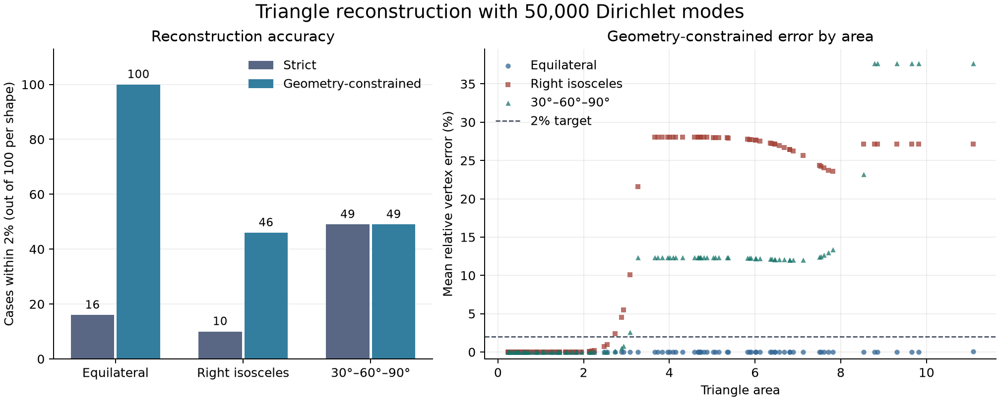

# Triangle reconstruction from 50,000 Dirichlet eigenvalues

At the dataset median area, the first **50,000** exact Dirichlet eigenvalues give **1.08%** mean relative vertex error for the $30^\circ$–$60^\circ$–$90^\circ$ triangle and **6.53%** for the right isosceles triangle. The equilateral control reaches **0.000004%** with a geometry-constrained fit. Across 300 cases, the strict inverse meets the **2%** target in **75** cases and the geometry-constrained fit in **195**. All fits use the physical time window $[10^{-4}, 2\cdot10^{-4}]$.

The benchmark uses three triangle shapes with analytic spectra and scales each shape to the 100 held-out areas in `triangle_drums.npz`. The area list reproduces the sizes of the project examples. The geometry and spectra of the analytic triangles are generated independently of the stored FEM spectra.

## Dirichlet spectrum and heat trace

Let $\Omega$ be the interior of a triangle. Its Dirichlet eigenvalues satisfy $-\Delta u_k=\lambda_k u_k$ with $u_k=0$ on $\partial\Omega$. Each eigenvalue appears with its multiplicity. For $t>0$, the heat semigroup has eigenvalues $e^{-t\lambda_k}$, so its trace is

$$
Z(t)=\operatorname{Tr}(e^{t\Delta})=\sum_{k=1}^{\infty}e^{-t\lambda_k}.
$$

Here $t$ is heat-flow time with diffusivity one. The product $t\lambda_k$ is dimensionless. Scaling the triangle by $s$ multiplies its area by $s^2$, its perimeter by $s$, and its eigenvalues by $s^{-2}$. Thus $Z_{s\Omega}(t)=Z_\Omega(t/s^2)$. A fixed physical $t$ probes earlier relative times on larger triangles. [Grieser and Maronna, §2](https://arxiv.org/html/1208.3163v2#S2)

For a polygon of area $A$, perimeter $P$, and interior angles $\theta_i$, the short-time Dirichlet expansion is

$$
Z(t)=\frac{A}{4\pi t}-\frac{P}{8\sqrt{\pi t}}+\frac{1}{24}\sum_i\left(\frac{\pi}{\theta_i}-\frac{\theta_i}{\pi}\right)+O(e^{-c/t}),\qquad c>0.
$$

The interior coefficient comes from integrating the free planar heat kernel on the diagonal, $(4\pi t)^{-1}$. Along a straight edge the Dirichlet image term subtracts $(4\pi t)^{-1}e^{-d^2/t}$, where $d$ is the inward distance from the edge. Its integral in $d$ is $-1/(8\sqrt{\pi t})$ per unit length. The wedge contribution gives the corner sum. For a triangle, $\sum_i\theta_i=\pi$, and the fit $\alpha/t+\beta/\sqrt t+\gamma$ has coefficients

$$
\alpha=\frac{A}{4\pi},\qquad
\beta=-\frac{P}{8\sqrt\pi},\qquad
\gamma=\frac{\pi\sum_i\theta_i^{-1}-1}{24}.
$$

The expansion is asymptotic as $t\downarrow0$. The trace identity holds at every positive time. Grieser and Maronna prove that the three exact invariants determine the triangle up to congruence. [Grieser and Maronna, Theorem 1 and §2](https://arxiv.org/html/1208.3163v2#S2)

## Reconstruction from the three invariants

Let $s=P/2$ be the semiperimeter and $r_{\mathrm{in}}=A/s$ the inradius. The tangency length at a vertex with angle $\theta_i$ is $r_{\mathrm{in}}\cot(\theta_i/2)$. The tangency lengths sum to $s$, which gives

$$
F=\frac{P^2}{4A}=\sum_{i=1}^3\cot\frac{\theta_i}{2},\qquad
R=24\gamma+1=\pi\sum_{i=1}^3\frac{1}{\theta_i}.
$$

Write the ordered angles as $\pi(x,y,z)$ with $x\le y\le z$. Then $x+y+z=1$ and $1/x+1/y+1/z=R$. At a fixed $x$,

$$
y+z=s_x=1-x,\qquad yz=p_x=\frac{s_x}{R-1/x},\qquad
y=\frac{2p_x}{s_x+\sqrt{s_x^2-4p_x}},\quad z=s_x-y.
$$

For $R>9$ the endpoints arise from the two isosceles cases. At $y=z$, the equation is $R=1/x+4/(1-x)$. At $x=y$ it is $R=2/x+1/(1-2x)$. Solving the two quadratics gives the interval

$$
x\in\left[\frac{2}{R-3+d},\frac{4}{R+3+d}\right],\qquad d=\sqrt{(R-1)(R-9)}.
$$

The reciprocal-angle sum is strictly convex on the plane of angle triples. Its level set in the ordered region runs between the two isosceles endpoints. At a scalene triangle, a stationary cotangent sum along that arc would require the three distinct half-angles to solve $\csc^2 v-C/v^2-D=0$ for common real constants $C,D$. The partial-fraction series for $\csc^2 v$ gives that $\csc^2 v-1/v^2$ is strictly increasing and strictly convex on $(0,\pi/2)$ by pairing the terms at $\pm k\pi$. When $C\le1$, adding $(1-C)/v^2$ preserves strict convexity. When $C>1$, that additional term is increasing, so the sum is strictly increasing. In either case the equation has at most two roots. This rules out a stationary point in the interior of the arc and establishes strict monotonicity there. The code tests whether the fitted $F$ lies between the endpoint values and recovers $x$ by a bracketed root solve when it does. The inequalities $R\ge9$ and $F\ge3\sqrt3$ follow from convexity. When $R=9$ the triangle is equilateral and $F=3\sqrt3$. [Grieser and Maronna, Proposition 1 and Lemmas 1–2](https://arxiv.org/html/1208.3163v2#S3)

Given the angles, the law of sines and the perimeter determine the sides $a_i=P\sin\theta_i/\sum_j\sin\theta_j$. If $a\le b\le c$ are the sides, one vertex representation is $(0,0)$, $(c,0)$, and $((b^2+c^2-a^2)/(2c),2A/c)$. This fixes the placement and keeps the recovered physical scale.

## Heat trace fit and geometry error

The benchmark forms $Z_K(t)=\sum_{k=1}^K e^{-t\lambda_k}$ and uses 80 geometrically spaced times in $[t_0,2t_0]$, with $t_0=10^{-4}$. Writing $u=t/t_0$ keeps the three columns of the least-squares design at comparable scales. The fit is in trace values, with design rows $(1/u,1/\sqrt u,1)$ and coefficients $(\alpha/t_0,\beta/\sqrt{t_0},\gamma)$. This is the same unweighted objective as fitting the three original basis functions in physical time.

The **strict fit** attempts the inverse above and records a failure when the fitted invariants are incompatible beyond numerical tolerance. The **geometry-constrained fit** seeks a valid triangle that minimizes the same trace objective. Both methods use the same eigenvalues and time samples. For a feasible strict fit the two methods share the same reconstruction.

At any scalene triangle the map from two angles and a positive scale to the three fit coefficients is locally invertible, by the nonvanishing derivative along the reciprocal-angle arc. An interior minimum in that region must therefore give the unconstrained least-squares coefficients. When those coefficients are incompatible, any minimizing positive-scale triangle must be on the isosceles boundary. The fallback searches the two branches with angles $(\phi,\phi,\pi-2\phi)$. For fixed $\phi$, $F$ and $\gamma$ are known and $A=P^2/(4F)$. Setting $p=P/\sqrt{t_0}$ gives the predicted trace

$$
\frac{p^2}{16\pi F u}-\frac{p}{8\sqrt{\pi u}}+\gamma.
$$

The squared residual is quartic in $p$. At each trial angle the implementation evaluates its nonnegative stationary candidates and the zero-scale limit. It searches 33 grid points on each angle branch and refines local minima in the sampled intervals. The repeated angle and the third angle are bounded away from zero by $10^{-4}$ radians. A zero-scale solution counts as a failure. This is a bounded numerical search.

The metric centers the reference and prediction, tests all six vertex correspondences, and finds the orthogonal alignment that minimizes squared Euclidean displacement for each. The reported error is the smallest, across correspondences, of the mean of the three ratios of displacement magnitude to the corresponding centered reference vertex radius. The orthogonal fit admits reflection and preserves scale. The target is a ratio at most $0.02$. Pass rates use every requested case as the denominator, including incompatible fits. Angle errors and feasible-only geometry errors describe the accepted reconstructions.

## Why truncation and discretization matter

For fixed $K$, $Z_K(t)\to K$ as $t\downarrow0$, while the full trace grows like $A/(4\pi t)$. Bringing the start of the window closer to zero reduces the remainder in the heat expansion and increases the contribution from omitted high modes. A workable window therefore has to control both errors simultaneously.

Write $T_K(t)=\sum_{k>K}e^{-t\lambda_k}$. Weyl's leading law $N(\Lambda)\sim A\Lambda/(4\pi)$ suggests the estimates

$$
T_K(t)\approx\frac{A}{4\pi t}e^{-t\lambda_K},\qquad
K\approx\frac{A}{4\pi t_0}(t_0\lambda_K).
$$

The first expression replaces the discrete counting measure by its leading density. The second explains why a fixed mode budget covers a much shorter span of $t_0\lambda$ on a large triangle. A rigorous bound is also available for triangles. Two congruent copies form a parallelogram, and a dilated parallelogram tiles into copies of that pair. Dirichlet bracketing and Weyl's law give the Pólya bound $\lambda_k\ge4\pi k/A$. Thus for $b=4\pi t/A$,

$$
0\le T_K(t)\le\frac{e^{-b(K+1)}}{1-e^{-b}}.
$$

This controls the trace contribution. The fit and the geometric inverse determine how that error propagates. [Ivrii, *100 years of Weyl's law*](https://arxiv.org/abs/1608.03963) · [Pólya, *On the eigenvalues of vibrating membranes*](https://doi.org/10.1112/plms/s3-11.1.419)

Let $D$ denote the fit design and $b_*$ the three exact scaled coefficients. The measured trace vector is $D b_*+r-T_K+\delta Z$, where $r$ is the heat expansion remainder, $T_K$ the omitted tail, and $\delta Z$ the error from approximate retained eigenvalues. The coefficient bias is $D^+(r-T_K+\delta Z)$. In this window, the least-squares design has a 2-norm condition number of about 468 after column normalization. The basis functions are similar on the interval, so a small trace perturbation can move the coefficients enough to change the recovered geometry. The residual only measures the component orthogonal to the design columns. For perturbed eigenvalues $\tilde\lambda_k$, the mean value theorem gives

$$
|\delta Z(t)|\le t\sum_{k\le K}e^{-t\min(\lambda_k,\tilde\lambda_k)}
|\tilde\lambda_k-\lambda_k|.
$$

The fitted invariants must also agree with each other. To first order, $\delta F/F=2\delta P/P-\delta A/A$. At fixed $\gamma=3/8$, for example, the entire feasible interval for $F$ is approximately $[5.828427,5.830447]$. Near equilateral, let $\theta_i=\pi(1/3+d_i)$ with $\sum_i d_i=0$. Taylor expansion gives $R-9=27\sum_i d_i^2+O(\|d\|^3)$ and $F-3\sqrt3=\sqrt3\pi^2\sum_i d_i^2+O(\|d\|^3)$. Both invariants start by measuring the same quadratic deviation. Resolving the shape therefore depends on smaller variations. This explains why exact uniqueness coexists with substantial sensitivity, especially near symmetric triangles.

## Analytic test spectra

The three analytic families are listed below. Positive indices are enumerated with multiplicity, and the eigenvalues are sorted before truncation.

| Triangle | Dirichlet eigenvalues | Index range |
|---|---|---|
| Equilateral with side $L$ | $\dfrac{16\pi^2}{9L^2}(m^2+mn+n^2)$ | $m,n\ge1$ |
| Right isosceles with leg $L$ | $\dfrac{\pi^2}{L^2}(m^2+n^2)$ | $m>n\ge1$ |
| $30^\circ$–$60^\circ$–$90^\circ$ with hypotenuse $L$ | $\dfrac{16\pi^2}{9L^2}(m^2+mn+n^2)$ | $m>n\ge1$ |

For the right isosceles case, cut a square along a diagonal and use the square eigenfunctions antisymmetric under that reflection. The hemi-equilateral case arises from the corresponding antisymmetric restriction of the equilateral spectrum. An area $A_i$ from the held-out list is used to dilate a template by $\sqrt{A_i/A_\mathrm{template}}$. Each reconstruction then uses its analytic spectrum. The unit and median-area controls isolate size changes at fixed angles. [Mårdby and Rowlett, *Spectral invariants of integrable polygons*](https://arxiv.org/abs/2409.14391)

## Benchmark results

### Scale controls

The unit controls use the length $L=1$ in the spectral formulas. The common area of the second set of controls is the median over all 1,000 project triangles, $A=2.9715312$. Each cell below gives the mean relative vertex error after alignment, or the strict fit's incompatibility status.

| Shape | Unit, strict | Unit, constrained | Median area, strict | Median area, constrained |
|---|---:|---:|---:|---:|
| Equilateral | $<10^{-6}$% | $<10^{-6}$% | $\gamma<1/3$ | 0.0000041% |
| Right isosceles | Incompatible | $<10^{-6}$% | 6.53% | 6.53% |
| $30^\circ$–$60^\circ$–$90^\circ$ | $<10^{-6}$% | $<10^{-6}$% | 1.08% | 1.08% |

At the median area, $t_0\lambda_{50000}\approx21.27$ in all three families. Summing the additional analytic modes with $t_0\lambda\le50$ gives an omitted tail of about $1.35$–$1.37\times10^{-6}$ at $t_0$. The bound above gives $1.55\times10^{-6}$. For the right isosceles control, the relative errors in $A$, $P$, and $\gamma$ are approximately $9.3\times10^{-9}$, $6.1\times10^{-7}$, and $3.85\times10^{-5}$. These coefficients reconstruct angles $(41.49^\circ,49.44^\circ,89.06^\circ)$. At an isosceles triangle, a perturbation that splits the equal angles contributes to the symmetric invariants only at second order. The median-area right isosceles fit moves into the feasible scalene region. The unit-scale fit lies just outside it, with a relative error of about $1.2\times10^{-11}$ in $\gamma$. This boundary decision can depend on floating-point arithmetic.

A diagnostic with the larger cutoff $t_0\lambda\le50$ retains roughly 117,800 modes at the median area. Over the same 80 time samples, the resulting trace differs from the three-term expression evaluated at the true invariants by at most $1.4\times10^{-12}$ in each family. The absolute fitted corner error is then at most $2.4\times10^{-11}$, compared with about $1.4\times10^{-5}$ at 50,000 modes. This isolates spectral truncation as the dominant source of coefficient error in these controls.

### Area sweep

The last 100 rows of the project dataset, at zero-based indices 900 to 999, supply areas from 0.230 to 11.086. Each of the three analytic templates is tested once at each area, giving 300 reconstructions.

| Shape | Strict feasible | Strict within 2% | Constrained feasible | Constrained within 2% | Median constrained error |
|---|---:|---:|---:|---:|---:|
| Equilateral | 16/100 | 16/100 | 100/100 | 100/100 | 0.000014% |
| Right isosceles | 15/100 | 10/100 | 100/100 | 46/100 | 15.86% |
| $30^\circ$–$60^\circ$–$90^\circ$ | 50/100 | 49/100 | 100/100 | 49/100 | 7.30% |
| Total | 81/300 | 75/300 | 300/300 | 195/300 | |



The constrained fit passes all 25 cases in the smallest area quartile for every template. In the second quartile it passes 25 equilateral, 21 right isosceles, and 24 scalene cases. In the upper two quartiles, the equilateral template accounts for all 50 passes. The fallback's search includes the exact equilateral shape, which is a single point where the two boundary branches meet. Accurate equilateral reconstructions can therefore persist when the unrestricted coefficients have significant errors.

At the largest area, the scalene control has $t_0\lambda_{50000}\approx5.70$. Its omitted tail is about 29.3, or 0.337% of the full trace at $t_0$. This correction is roughly 70 times the true corner coefficient $5/12$. The fitted perimeter is negative and the constrained fit has 37.7% vertex error. Across the 100 scalene cases the median relative raw-trace residual is only $3.64\times10^{-10}$. These results illustrate why the residual and the fractional tail both need to be interpreted on the scale of the shape information.

## Project spectrum resolution

The fixed-budget results describe the analytic controls at the sizes present in the held-out data. Individual triangles of the same area can have different reconstruction errors because the boundary term, corner invariant, and conditioning vary with shape. The shared area list supports a matched comparison between families.

The project's current data contain 30 FEM eigenvalues per triangle. The P1 finite-element operator in `src/drums/data/spectrum.py` has one degree of freedom per interior mesh vertex, giving an upper bound on the number of available discrete eigenvalues. Resolving the high end of the spectrum to the accuracy needed here also requires a converged spatial representation. In particular, the local mesh size must be small compared with the wavelength of those modes. A run with 50,000 accurate FEM eigenvalues would need a separate mesh and eigenvalue convergence study.

For the tested window, 50,000 accurate modes are sufficient for some shapes and sizes at the 2% target. Spectral resolution should be assessed together with $t_0\lambda_K$, the omitted tail, and the local sensitivity of the invariant inversion.

As an implementation check, the three exact invariants computed directly from the vertices of all 1,000 dataset triangles were passed to the strict inverse. All reconstructions were feasible, with a maximum relative vertex error of $5.2\times10^{-10}$. This check exercises the geometric inverse separately from estimating the invariants from a truncated spectrum.

## Reproducing the benchmark

Run from the repository root with NumPy and SciPy available.

```bash
python training/triangle_heat_trace/experiment.py \
  --dataset triangle_drums.npz \
  --modes 50000 --t-min 1e-4 --t-max 2e-4 \
  --output training/triangle_heat_trace/results.json
```

`reconstruct.py` implements the fit, compatibility test, and geometric inversion. `experiment.py` generates the analytic spectra and records the protocol, dataset checksum, software versions, controls, summaries, and per-case values in [results.json](results.json). The figure can be regenerated with Matplotlib installed.

```bash
python training/triangle_heat_trace/plot_results.py \
  training/triangle_heat_trace/results.json \
  training/triangle_heat_trace/reconstruction_50k.png
```
