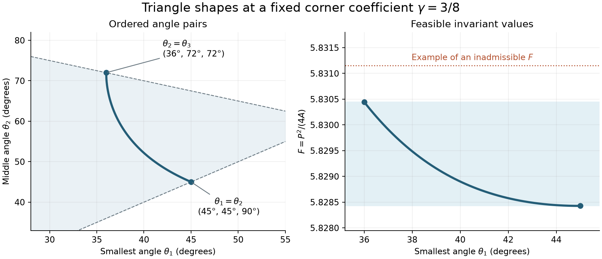
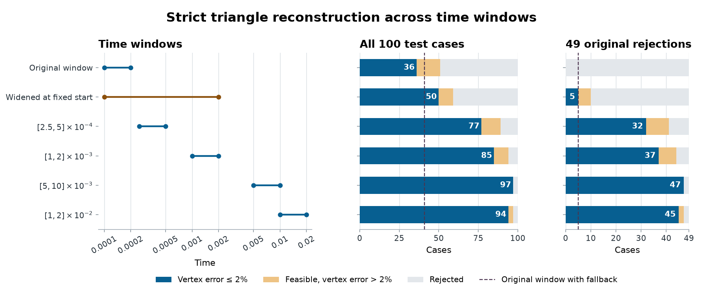
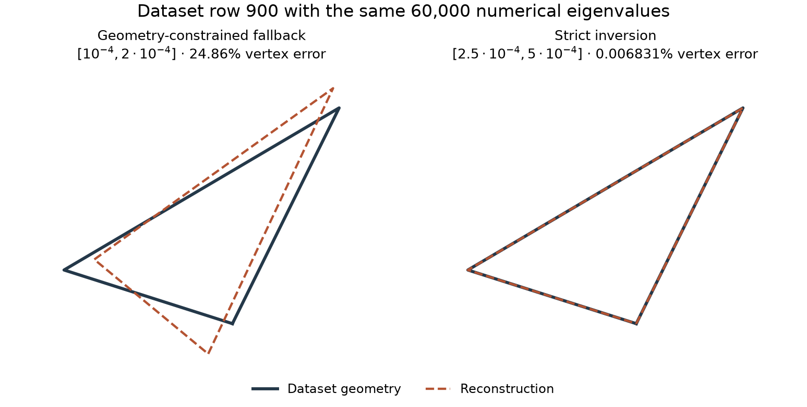

# Reconstruction of Triangular Drums from Finite Heat Traces

Changing the time window raised the number of strict reconstructions within 2% vertex error from **36 to 97 out of 100**. Both runs used the same 60,000 numerical Dirichlet eigenvalues per test triangle. The original fit used $[10^{-4},2\cdot10^{-4}]$ and the best fit among the tested windows used $[0.005,0.01]$. The result connects the theorem for the full spectrum to a practical choice in its numerical implementation. Short times give an accurate asymptotic model of the full heat trace and put more weight on modes beyond the available spectral cutoff.

[Speaker notes and questions](SPEAKER_NOTES.md) · [Window sweep data](window_results.json) · [Original test results](../real_test_60000/results.json)

## What the full spectrum determines

On a triangle $\Omega$, the Dirichlet eigenpairs satisfy $-\Delta u_k=\lambda_k u_k$ with $u_k=0$ on the boundary. The eigenvalues include multiplicities. The time $t$ is heat-flow time with diffusivity one, so $t\lambda_k$ is dimensionless. The full heat trace is

$$
Z(t)=\operatorname{Tr}(e^{t\Delta})=\sum_{k=1}^{\infty}e^{-t\lambda_k}.
$$

For a triangle with area $A$, perimeter $P$ and interior angles $\theta_i$, the short-time expansion is

$$
Z(t)=\frac{\alpha}{t}+\frac{\beta}{\sqrt t}+\gamma+r(t),\qquad
\alpha=\frac{A}{4\pi},\quad
\beta=-\frac{P}{8\sqrt\pi},\quad
\gamma=\frac{\pi\sum_i\theta_i^{-1}-1}{24}.
$$

The free planar heat kernel contributes $A/(4\pi t)$. Integrating the negative Dirichlet image term near a straight edge gives $-1/(8\sqrt{\pi t})$ per unit edge length. Each corner contributes $(\pi/\theta_i-\theta_i/\pi)/24$, and the angles sum to $\pi$. For a fixed polygon the remainder is exponentially small as $t\downarrow0$.

With the full trace, three successive limits give $\alpha=\lim_{t\downarrow0}tZ(t)$, $\beta=\lim_{t\downarrow0}\sqrt t[Z(t)-\alpha/t]$, and $\gamma=\lim_{t\downarrow0}[Z(t)-\alpha/t-\beta/\sqrt t]$. Grieser and Maronna prove that the resulting area, perimeter and reciprocal-angle sum determine the triangle up to congruence. Scaling the sides by $s$ divides every eigenvalue by $s^2$, so the same relative heat time scales as $s^2$. [Grieser and Maronna, §§2–4](https://arxiv.org/html/1208.3163v2)

## From a finite spectrum to a triangle

The input is the first $K$ Dirichlet eigenvalues in physical units. At each time $t_j$ the code reuses all $K$ values to compute $Z_K(t_j)=\sum_{k=1}^{K}e^{-t_j\lambda_k}$. It fits the three-term model by ordinary least squares in trace space. The real-data runs use 100 geometrically spaced times, including both endpoints. The calculation uses $u=t/t_{\min}$ and column normalization to improve the numerical scaling of the design matrix. This preserves the unweighted least-squares objective in the original trace values.

### Strict inversion

The three fitted coefficients are converted to $A$, $P$ and $\gamma$. Positive $A$ and $P$ and the bound $\gamma\ge1/3$ are basic checks. Joint feasibility uses the two angle invariants

$$
F=\frac{P^2}{4A}=\sum_{i=1}^3\cot\frac{\theta_i}{2},
\qquad
G=\sum_{i=1}^3\frac1{\theta_i}=\frac{24\gamma+1}{\pi}.
$$

At fixed $G>9/\pi$, the ordered angle triples form an arc whose endpoints have two equal angles. The function $F$ varies strictly monotonically along that arc. The code computes the endpoint values, checks whether the fitted $F$ lies in the resulting interval and solves a bracketed scalar equation for the angles. The law of sines and the recovered $P$ give side lengths and then vertices. At $G=9/\pi$ all angles are $60^\circ$. [Grieser and Maronna, §3](https://arxiv.org/html/1208.3163v2#S3)



*Figure 1. With $\gamma=3/8$, the feasible $F$ interval runs from 5.828427 to 5.830447. The endpoints have angles $(45^\circ,45^\circ,90^\circ)$ and $(36^\circ,72^\circ,72^\circ)$. The dotted orange line illustrates an incompatible $F$ at this $\gamma$. The full fit allows $\gamma$ to vary.*

### Why the fallback searches isosceles triangles

Let $c=(\alpha,\beta,\gamma)$, $z=(Z_K(t_j))_j$ and let $X$ have rows $(1/t_j,1/\sqrt{t_j},1)$. Write $\hat c$ for the free least-squares estimate and $\mathcal C$ for the feasible coefficient triples. Orthogonality of the least-squares residual gives

$$
L(c)=\|Xc-z\|^2=L(\hat c)+\|X(c-\hat c)\|^2.
$$

When $\hat c$ is outside $\mathcal C$, an attained minimum must lie on the boundary. From any interior candidate $c$, a sufficiently small step toward $\hat c$ stays feasible and strictly decreases $L$.

The differential of the angle map $(\theta_1,\theta_2)\mapsto(F,G)$ is invertible at every scalene triangle by Lemma 1(b) of Grieser and Maronna. Adding the positive scale $P$ makes the three-dimensional map to $(A,P,\gamma)$ locally invertible as well, since $A=P^2/(4F)$ and $\gamma=(\pi G-1)/24$. Thus each scalene triangle maps to an interior point of $\mathcal C$. Every attained nondegenerate minimum for incompatible $\hat c$ has two equal angles, with the equilateral triangle included. This argument also applies if an optimizer is given two unrestricted angles and a scale. [Grieser and Maronna, §§3–4](https://arxiv.org/html/1208.3163v2#S3)

The implementation searches the two branches $(\phi,\phi,\pi-2\phi)$, which meet at $\phi=\pi/3$. At a fixed $\phi$, $A=P^2/(4F(\phi))$, so each trace residual is quadratic in $P$. The squared loss is quartic, and the code compares its positive stationary roots and the zero-scale limit. It checks 33 angles on each branch and refines local minima in the sampled intervals and near endpoints. This is a bounded numerical search. [Implementation notes](../README.md)

## Where the coefficient error comes from

Write $T_K(t)=\sum_{k>K}e^{-t\lambda_k}$ for the omitted tail, and $\delta z$ for the perturbation from numerical eigenvalues. On the sampled grid,

$$
z_K^{\mathrm{num}}=Xc_*+r-T_K+\delta z,\qquad
\hat c-c_*=X^+(r-T_K+\delta z).
$$

The pseudoinverse $X^+$ maps trace error to coefficient error. Components along the design columns can substantially move the coefficients while leaving a small fit residual. In the baseline window the column-normalized design has a condition number of about 470. An incompatible fit is therefore consistent with a trace curve that looks accurate on the scale of $Z_K$.

The weight of the last retained mode is $e^{-t\lambda_K}$. The whole tail sums many additional contributions. The leading Weyl density gives the approximation $T_K(t)\approx \frac{A}{4\pi t}e^{-t\lambda_K}$. Two congruent copies of a triangle form a parallelogram that tiles the plane, so Pólya's inequality for the exact Dirichlet spectrum gives $\lambda_j\ge4\pi j/A$. Summing the resulting geometric series gives

$$
0\le T_K(t)\le \frac{e^{-b(K+1)}}{1-e^{-b}},\qquad b=\frac{4\pi t}{A}.
$$

The lower endpoint of the window controls the largest omitted contribution. The upper endpoint controls how far the fit goes from the short-time limit, with the relevant time scale set by the size and shape of the triangle. At fixed $K$, $Z_K(t)\to K$ as $t\downarrow0$ while the full trace grows like $A/(4\pi t)$. [Weyl asymptotics](https://arxiv.org/abs/1608.03963) · [Pólya's eigenvalue bound](https://doi.org/10.1112/plms/s3-11.1.419)

## Experimental design

The **analytic controls** use exact spectra of equilateral, right isosceles and $30^\circ$–$60^\circ$–$90^\circ$ templates. The template shapes are scaled to areas from the dataset. At the full-dataset median area $A=2.97153$, the right isosceles error fell from 6.535% at 50,000 modes and 80 time samples to 0.738% at 60,000 modes and 100 time samples. The scalene template went from 1.078% to 0.0138%. A one-factor check on the right isosceles control gave 6.493% with 50,000 modes and 100 samples and 0.744% with 60,000 modes and 80 samples. The higher mode count accounts for most of that improvement. [Analytic spectra](https://link.springer.com/article/10.1007/s00041-025-10202-6) · [Analytic benchmark](../README.md)

The **real geometry benchmark** uses the original vertices in rows 900–999 of `triangle_drums.npz`. The dataset stores 30 FEM eigenvalues per triangle. To compute 60,000 numerical modes for each geometry, the implementation uses a Fourier–Bessel basis at the largest corner, solves overlapping frequency windows on the remaining edge and refines and stitches the roots. The unit-area eigenfrequencies are mapped back to physical eigenvalues by $\lambda=k_{\mathrm{unit}}^2/A$. Two analytic controls agreed in mode count across the search range. Seven test geometries received targeted spectral repairs, after which the checked overlaps agreed in mode count. Fourteen rows retained an overlap frequency discrepancy at the numerical tolerance. The reconstruction takes eigenvalues as input and uses the true vertices to score the outcome and audit solver accuracy. [Fourier–Bessel scaling for triangular billiards](https://doi.org/10.1103/PhysRevResearch.4.013138) · [Spectral solver protocol](../real_test_60000/README.md)

The metric centers the two vertex sets and examines all six correspondences. For each one it aligns the vertices by an orthogonal least-squares fit, allowing reflections and preserving scale. It then averages the displacement of each vertex divided by that vertex's distance from the true centroid, and takes the smallest such average over correspondences. A pass has error at most 2%. An incompatible fit counts in the denominator of 100.

## Results on the 100 test triangles

### Baseline and fallback

At $K=60\,000$ and $t\in[10^{-4},2\cdot10^{-4}]$, 51 cases had compatible free coefficients and 36 passed the 2% threshold. Of the other 49 cases, 29 had $\hat\gamma<1/3$, 18 had jointly incompatible invariants and two had nonpositive area or perimeter estimates. The fallback produced 49 additional geometries and added **five** passes, for **41 out of 100** in total. Among those 49 fallback cases the median vertex error was **13.58%** and the 90th percentile was **25.99%**. Across all 100 cases with fallback enabled the median was 3.54%.

Size mattered in this window. With fallback enabled, 37 of the 50 smaller triangles passed, compared with 4 of the 50 larger triangles. Among the 49 baseline refusals, the median $t_{\min}\lambda_K$ was 12.63. The two-term Weyl estimate for the median tail at $t_{\min}$ was 0.0156 and the largest was 9.44. At $2\cdot10^{-4}$ these values were $2.57\cdot10^{-8}$ and 0.00507. This scale matters because $\gamma$ is typically a fraction of one while the trace can be in the thousands. [Per-case baseline results](../real_test_60000/results.json)

### Changing the time window

Each row below uses strict inversion and 100 geometric time samples. The mode-count comparison truncates the numerical spectra already computed for the same geometries. The other rows use the same 60,000 values. The data file records the other windows in the sweep as well. [Full sweep data](window_results.json)

| Modes | Time window | Compatible / 100 | Vertex error ≤ 2% / 100 |
|---:|---|---:|---:|
| 50,000 | $[10^{-4},2\cdot10^{-4}]$ | 45 | 34 |
| 60,000 | $[10^{-4},2\cdot10^{-4}]$ | 51 | 36 |
| 60,000 | $[10^{-4},2\cdot10^{-3}]$ | 59 | 50 |
| 60,000 | $[2.5\cdot10^{-4},5\cdot10^{-4}]$ | 89 | 77 |
| 60,000 | $[10^{-3},2\cdot10^{-3}]$ | 94 | 85 |
| 60,000 | $[0.005,0.01]$ | **97** | **97** |
| 60,000 | $[0.01,0.02]$ | 97 | 94 |



*Figure 2. Strict reconstruction on all 100 test cases and on the subset of 49 originally incompatible fits. The widened window keeps the original left endpoint. Dashed lines show how many passes the baseline fallback produces in each group.*

Widening the window while keeping $t_{\min}=10^{-4}$ retains the early samples where the tail is largest. The column-normalized design condition number improved from about 470 to 31 in the widened window, and strict passes rose from 36 to 50. Moving both endpoints suppressed the tail and improved the measured reconstruction further. In the selected window $[0.005,0.01]$, 47 of the original 49 incompatibilities became strict passes. Rows 924, 944 and 963 remained or became incompatible. The Pólya tail bound at the new left endpoint is below $4\cdot10^{-146}$ for every test geometry. Finite-time model error and numerical eigenvalue error still affect the coefficient fit. The next shifted window gave 94 passes. Window selection was exploratory on these same 100 geometries. [Sweep data and per-window diagnostics](window_results.json)

A separate fit held the baseline window fixed and estimated the missing tail with the area and perimeter terms from Weyl's counting law. For $\Lambda=\lambda_K$, the approximation is

$$
\widehat T_K(t)=\frac{A}{4\pi t}e^{-t\Lambda}
-\frac{P}{8\sqrt{\pi t}}\operatorname{erfc}(\sqrt{t\Lambda}).
$$

Fitting the three-term model minus this estimated tail to $Z_K$ yielded 70 compatible cases and 48 passes. The correction keeps the fit linear in the three coefficients when the measured cutoff $\Lambda$ is fixed. Its tail model remains an approximation. [Two-term Weyl counting law](https://arxiv.org/abs/1608.03963) · [Tail-fit results](window_results.json)

### Two cases that explain the result

**Row 900 illustrates truncation bias.** It has $A=6.8115$ and angles near $(33.17^\circ,48.27^\circ,98.56^\circ)$. At $t_{\min}=10^{-4}$, $t_{\min}\lambda_K=11.13$ and the omitted trace is about 0.079. The fitted corner coefficient is $-0.573$ while the geometric value is $0.416$. The fallback selects an isosceles triangle with 24.86% error. Moving the window to $[2.5\cdot10^{-4},5\cdot10^{-4}]$ with the same eigenvalues recovers a scalene triangle with 0.00683% error.

The archived spectrum also lets us delete a known block of modes. Removing modes 50,001 through 60,000 reduced the first trace sample by 0.4233 and shifted the fitted $\gamma$ by $-5.33$ at the original times. Projecting the lost trace through the same least-squares design reproduced the coefficient shifts to within $2.5\cdot10^{-11}$ in this calculation. [Nested-mode diagnostic](window_results.json)



*Figure 3. The solid outline is the original geometry. The dashed outline is the reconstruction after rigid alignment with the physical scale preserved.*

**Row 901 illustrates sensitivity with a small tail.** The baseline cutoff exponent is about 45.5 and the Pólya bound gives a tail below $3\cdot10^{-17}$. Two true angles are about $69.05^\circ$ and $69.85^\circ$. A fitted corner error of about $1.84\cdot10^{-5}$ accompanies a strict vertex error of 7.88%. Close to the isosceles boundary the geometric inverse can amplify small errors from the numerical spectrum and the finite-time model. [Per-case baseline results](../real_test_60000/results.json)

## Selecting a working window

The spectral cutoff and the window are coupled. The dimensionless product $t_{\min}\lambda_K$ is a starting point for assessing the missing tail, with the factor $A/(4\pi t_{\min})$ setting its scale in the trace. The tail should be small on the scale needed to estimate $\gamma$. The upper time should stay in the range where the short-time model gives stable invariants for that geometry. Comparing neighboring windows and checking both coefficient feasibility and vertex accuracy on validation examples helps assess that stability.

At fixed positive times, increasing $K$ makes the truncated trace approach the full trace on that window. Its three-term least-squares estimate can retain a finite-time bias. In the joint limit with exact modes, one can keep the ratios $t_j/t_{\min}$ fixed and let $t_{\min}/A$ scale like $K^{-a}$ for $0<a<1$. The Pólya bound then drives the tail to zero while the short-time remainder also vanishes. After fitting the columns $(1/u,1/\sqrt u,1)$, the map back to $(\alpha,\beta,\gamma)$ multiplies the first two coefficients by $t_{\min}$ and $\sqrt{t_{\min}}$. Hence vanishing trace perturbations give convergence to the true coefficients on this design.

When the true triangle is scalene, its coefficient triple lies in the interior of the feasible set. A converging sequence of free estimates is therefore feasible for all sufficiently large **finite** $K$. Conversely, for a sequence of isosceles triangles, the smaller gap between consecutive ordered angles is zero throughout and remains zero in any nondegenerate limit. These observations explain how the fallback can give way to strict scalene reconstruction once the coefficients are accurate enough.

## Appendix on the angular inverse

Let $x\le y\le z$ be the angles divided by $\pi$, and set $R=\pi G=24\gamma+1$. At a fixed $x$ we have $y+z=s=1-x$ and $yz=p=s/(R-1/x)$. The remaining angles follow from $y=2p/(s+\sqrt{s^2-4p})$ and $z=s-y$. For $R>9$, the endpoints result from solving $R=1/x+4/(1-x)$ when $y=z$ and $R=2/x+1/(1-2x)$ when $x=y$. With $d=\sqrt{(R-1)(R-9)}$, the bracket is

$$
\frac{2}{R-3+d}\le x\le\frac{4}{R+3+d}.
$$

The nonzero differential behind this bracket has a short proof. Dependence of the gradients of $F$, $G$ and $\sum_i\theta_i$ at three distinct angles would make the three distinct half-angles solve $\csc^2 v-C/v^2=D$ for common constants $C,D$. A relation with zero coefficient on $F$ would already force the reciprocal angle squares to be equal. The partial fraction expansion of $\csc^2 v$ gives that $\csc^2 v-1/v^2$ is strictly convex and strictly increasing on $(0,\pi/2)$. For $C\le1$, adding $(1-C)/v^2$ preserves strict convexity. For $C>1$, the added term is increasing, so the sum is strictly increasing. A horizontal line can meet the resulting function at most twice. Thus the gradients are independent in the scalene region. On a fixed-$G$ arc the derivative of $F$ is nonzero in the interior, giving the monotone scalar root used by the inverse. [Grieser and Maronna, Lemmas 1 and 2](https://arxiv.org/html/1208.3163v2#S3)

## Code and reproduction

| Location under `training/triangle_heat_trace` | Role |
|---|---|
| `reconstruct.py` | `fit_trace` builds and fits the truncated trace. `reconstruct` inverts compatible invariants. `constrained_reconstruct` searches the isosceles boundary. `vertex_error` measures geometric agreement. |
| `experiment.py` | Generates the exact template spectra and the area-matched analytic controls. |
| `real_test_60000/solve_dataset.py` and `scan_robust.py` | Compute and checkpoint the numerical frequency windows. |
| `real_test_60000/aggregate.py` | Validates and assembles the spectra, runs the inverse and records the baseline metrics. |
| `presentation_report/window_sweep.py` | Repeats the strict fits on the saved spectra and regenerates the window comparison. |

The original spectral batch ran for 46 minutes on five local processes. The archive of six million eigenvalues occupies 37.83 MB. The window comparison reuses that archive. From the repository root, run

```bash
base=training/triangle_heat_trace
python "$base/presentation_report/window_sweep.py" \
  --dataset triangle_drums.npz \
  --spectra "$base/real_test_60000/spectra.npz" \
  --reconstruct "$base/reconstruct.py" \
  --results "$base/presentation_report/window_results.json" \
  --figure "$base/presentation_report/window_sweep.png" \
  --weyl
```

[Analytic protocol](../README.md) · [Real spectra and baseline protocol](../real_test_60000/README.md) · [Speaker notes](SPEAKER_NOTES.md)
